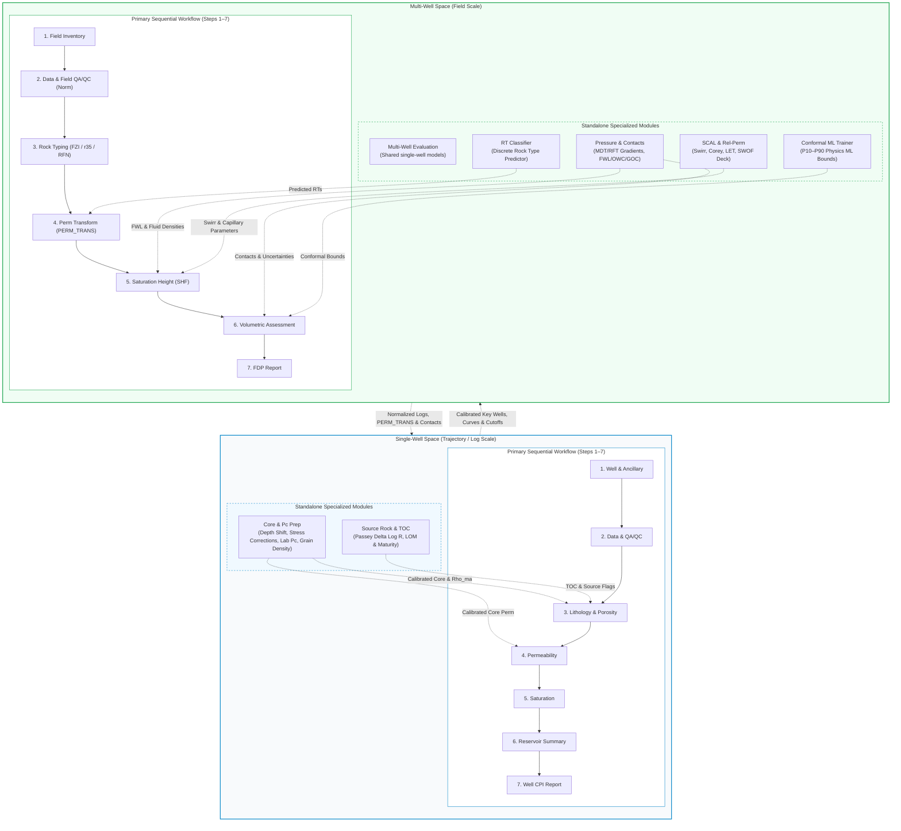

# Domain Workflows & Technical Foundations

`quick_pp` provides a dual-space architecture that bridges single-well deterministic petrophysics with field-scale multi-well reservoir characterization. Both spaces distinguish between **Primary Sequential Workflow Steps** (numbered 1 through 7) and **Standalone Specialized Modules**, with full project state, curves, ancillary records, hole sections, and calibrated models portable via `.qpp` Handover Packages.

---

## Architectural Overview

---

## Workflow Step Mapping Matrix

The tables below define the 1-to-1 correspondence between the SvelteKit workbench UI (`WorkflowStepper.svelte`), backend modules, and technical documentation anchors.

The right-pane crossplot selector shows only plots supported by the active single- or multi-well space. Plots relevant to the current step appear first; other plots are grouped by workflow step or standalone module. Auto follows the current step, or shows an empty state when that step has no recommended crossplot. A manual selection remains active across steps in the same space; switching spaces resets it to Auto if the plot is unavailable there. Relevant plots remain listed even when their input data is not yet available.

### Single-Well Space

| Step Category | Stepper ID | UI Component | Markdown Anchor | Primary Petrophysical Function |
| :--- | :--- | :--- | :--- | :--- |
| **Step 1** | `ancillary` | `InspectorAncillary.svelte` | [`#sw-step-1-ancillary`](single_well.md#sw-step-1-ancillary) | Well header ($R_{mf}$, BHT, datum), depth-zoned Hole Sections (`BS`, mud program), tops, core/SCAL/FPT tables & minimum curvature trajectory (`TVD`, `TVDSS`) |
| **Step 2** | `qaqc` | `InspectorQaqc.svelte` | [`#sw-step-2-qaqc`](single_well.md#sw-step-2-qaqc) | 4-criterion bad-hole flagging, borehole environmental & radial invasion corrections (`*_ENV_CORR`, `*_SIGMA`, `*_QC_CONF`), P&T/Invasion QC plots, imputation, resolution enhancement & curve splicing |
| **Step 3** | `litho-poro` | `InspectorLithoPoro.svelte` | [`#sw-step-3-litho-poro`](single_well.md#sw-step-3-litho-poro) | $V_{\text{sh}}$, SSC ternary, Thomas-Stieber ($V_{\text{lam}}, V_{\text{disp}}, V_{\text{str}}$), multi-mineral SLSQP, $\phi_t$, $\phi_e$, continuous $\rho_{fl}$, coal flagging & reversible manual overrides |
| **Step 4** | `perm` | `InspectorPerm.svelte` | [`#sw-step-4-perm`](single_well.md#sw-step-4-perm) | Empirical single-well permeability: Choo, Kozeny-Carman, Timur, Tixier & Coates-Dumanoir (with optional Thomas-Stieber thin-bed weighting & core calibration) |
| **Step 5** | `saturation` | `InspectorSaturation.svelte` | [`#sw-step-5-saturation`](single_well.md#sw-step-5-saturation) | Archie, Waxman-Smits ($Q_v, B$), Simandoux, Indonesian, Dual Water, water-leg $m$ calibration, continuous $m(\phi)$, fluid typing & manual overrides |
| **Step 6** | `ressum` | `InspectorResSum.svelte` | [`#sw-step-6-ressum`](single_well.md#sw-step-6-ressum) | Net Reservoir / Net Pay cutoffs (optional $k_{\text{cut}}$), PRMS 95% HCPV cutoff sensitivity, zonal summation, Cardwell-Parsons log blocking & stochastic log uncertainty |
| **Step 7** | `report` | `InspectorReport.svelte` | [`#sw-step-7-report`](single_well.md#sw-step-7-report) | Automated Single-Well CPI report with log QC/invasion audit, subsurface gate checks (`CHK-01`+) & A4 PDF export |
| **Standalone** | `scal` | `InspectorScal.svelte` | [`#sw-standalone-core-pc`](single_well.md#sw-standalone-core-pc) | **Core & Pc Prep**: Core depth shifting, overburden/Klinkenberg corrections, lab-to-res $P_c$ scaling & multi-log grain-density ($\rho_{ma}$) correlation |
| **Standalone** | `toc` | `InspectorToc.svelte` | [`#sw-standalone-source-rock`](single_well.md#sw-standalone-source-rock) | **Source Rock & TOC**: Passey $\Delta\log R$, Hood LOM maturity, core geochemical calibration & log overlays |

### Multi-Well Space

| Step Category | Stepper ID | UI Component | Markdown Anchor | Primary Field Petrophysical Function |
| :--- | :--- | :--- | :--- | :--- |
| **Step 1** | `inventory` | `MultiWellInventory.svelte` | [`#mw-step-1-inventory`](multi_well.md#mw-step-1-inventory) | Multi-well completeness audit, canonical mnemonic aliasing & bulk LAS/ancillary ingestion |
| **Step 2** | `qaqc` | `MultiWellQaqc.svelte` | [`#mw-step-2-qaqc`](multi_well.md#mw-step-2-qaqc) | Key-well stratigraphic quantile normalization, multi-well bad-hole/environmental conditioning & pooled missing-data imputation |
| **Step 3** | `rock-typing` | `MultiWellRockTyping.svelte` | [`#mw-step-3-rock-typing`](multi_well.md#mw-step-3-rock-typing) | Discrete Rock Typing (`ROCK_FLAG`) on Core or Logs via Amaefule FZI / RQI, Winland $r_{35}$, Lucia RFN & GMM/Lorenz cutoffs |
| **Step 4** | `perm-transform` | `MultiWellPermTransform.svelte` | [`#mw-step-4-perm-transform`](multi_well.md#mw-step-4-perm-transform) | Rock-type partitioned power-law poro-perm regressions ($k = a_k \cdot \phi^{b_k}$) generating field-wide `PERM_TRANS` |
| **Step 5** | `shf` | `MultiWellShf.svelte` | [`#mw-step-5-shf`](multi_well.md#mw-step-5-shf) | Saturation-Height Modeling (Leverett $J$ / Skelt-Harrison), Stick Plot geological correlation, fluid contacts/limits & log reconciliation |
| **Step 6** | `volumetrics` | `MultiWellVolumetrics.svelte` | [`#mw-step-6-volumetrics`](multi_well.md#mw-step-6-volumetrics) | Probabilistic LHS STOIIP/GIIP (`AREA` / `GRV`, Log-Average vs. 1D Hypsometric SHF), PRMS cutoff sensitivity, inherited contacts & Tornado |
| **Step 7** | `report` | `InspectorReport.svelte` | [`#mw-step-7-report`](multi_well.md#mw-step-7-report) | Field Development Plan (`FDP_FULL`, `QAQC_SUMMARY`, `RESSUM_ONLY`) dossier, subsurface gate-check audit & A4 PDF export |
| **Standalone** | `batch-evaluation` | `MultiWellEvaluation.svelte` | [`#mw-standalone-batch-evaluation`](multi_well.md#mw-standalone-batch-evaluation) | Preview and apply isolated single-well calculations by well and zone |
| **Standalone** | `swirr-corr` | `MultiWellSwirr.svelte` | [`#mw-standalone-scal-relperm`](multi_well.md#mw-standalone-scal-relperm) | **SCAL & Rel-Perm**: Field $S_{\text{wirr}}$ fit, PRT pore-throat distributions, Brooks-Corey, LET & ECLIPSE `SWOF` decks |
| **Standalone** | `fpt` | `MultiWellFpt.svelte` | [`#mw-standalone-fpt`](multi_well.md#mw-standalone-fpt) | **Pressure & Contacts**: Zone-filtered MDT/RFT gradients on `TVDSS`, excess pressure & `FWL`/`OWC`/`GOC` $\pm 1\sigma$ |
| **Standalone** | `rt-classifier` | `MultiWellRtClassifierTrainer.svelte` | [`#mw-standalone-rt-classifier`](multi_well.md#mw-standalone-rt-classifier) | **RT Classifier**: Supervised discrete rock-type classification (Random Forest / Gradient Boosting) & model registry |
| **Standalone** | `ml-training` | `MultiWellMlTrainer.svelte` | [`#mw-standalone-ml-training`](multi_well.md#mw-standalone-ml-training) | **Conformal ML Trainer**: Physics-informed continuous ML with distribution-free P10–P90 bounds |

---

## Detailed Technical References

- [**Single-Well Petrophysical Workflow**](single_well.md):
  Covers the 7-step deterministic evaluation pipeline (starting from Well & Ancillary setup through Data & QA/QC to CPI reporting) and the 2 standalone modules (Core & Pc Prep, Source Rock & TOC).

- [**Multi-Well Field Evaluation Workflow**](multi_well.md):
  Covers the 7-step field characterization pipeline (including FZI/Winland/Lucia rock typing and power-law `PERM_TRANS` transforms) and the 5 standalone specialized modules (Multi-Well Evaluation, SCAL & Rel-Perm, Formation Pressure & Contacts, RT Classifier, Conformal PIML).
