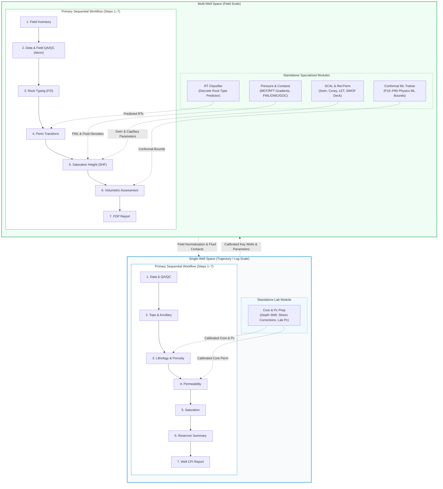

# Domain Workflows & Technical Foundations

`quick_pp` provides a dual-space architecture that bridges single-well deterministic petrophysics with field-scale multi-well reservoir characterization. Both spaces distinguish between **Primary Sequential Workflow Steps** (numbered 1 through 7) and **Standalone Specialized Modules**.

---

## Architectural Overview

---

## Workflow Step Mapping Matrix

The tables below define the 1-to-1 correspondence between the SvelteKit workbench UI (`WorkflowStepper.svelte`), backend modules, and technical documentation anchors.

### Single-Well Space

| Step Category | Stepper ID | UI Component | Markdown Anchor | Primary Petrophysical Function |
| :--- | :--- | :--- | :--- | :--- |
| **Step 1** | `qaqc` | `InspectorQaqc.svelte` | [`#sw-step-1-qaqc`](single_well.md#sw-step-1-qaqc) | Outer limits, bad-hole flagging & curve repair |
| **Step 2** | `ancillary` | `InspectorAncillary.svelte` | [`#sw-step-2-ancillary`](single_well.md#sw-step-2-ancillary) | Minimum curvature trajectory & tops ingestion |
| **Step 3** | `litho-poro` | `InspectorLithoPoro.svelte` | [`#sw-step-3-litho-poro`](single_well.md#sw-step-3-litho-poro) | $V_{\text{sh}}$, SSC ternary, multi-mineral SLSQP, $\phi_e$ & $\phi_t$ |
| **Step 4** | `perm` | `InspectorPerm.svelte` | [`#sw-step-4-perm`](single_well.md#sw-step-4-perm) | Choo, Timur-Coates, Tixier & Morris-Biggs permeability |
| **Step 5** | `saturation` | `InspectorSaturation.svelte` | [`#sw-step-5-saturation`](single_well.md#sw-step-5-saturation) | Archie, Waxman-Smits ($Q_v, B$), Dual Water & Indonesian |
| **Step 6** | `ressum` | `InspectorResSum.svelte` | [`#sw-step-6-ressum`](single_well.md#sw-step-6-ressum) | Net Pay cutoffs, zonal summation & log blocking upscaling |
| **Step 7** | `report` | `InspectorReport.svelte` | [`#sw-step-7-report`](single_well.md#sw-step-7-report) | Automated CPI well report compilation |
| **Standalone** | `scal` | `InspectorScal.svelte` | [`#sw-standalone-core-pc`](single_well.md#sw-standalone-core-pc) | **Core & Pc Prep**: Depth shifting, stress corrections & lab-to-res $P_c$ |

### Multi-Well Space

| Step Category | Stepper ID | UI Component | Markdown Anchor | Primary Field Petrophysical Function |
| :--- | :--- | :--- | :--- | :--- |
| **Step 1** | `inventory` | `MultiWellInventory.svelte` | [`#mw-step-1-inventory`](multi_well.md#mw-step-1-inventory) | Multi-well completeness audit & canonical mnemonic aliasing |
| **Step 2** | `qaqc` | `MultiWellQaqc.svelte` | [`#mw-step-2-qaqc`](multi_well.md#mw-step-2-qaqc) | Key-well designation & stratigraphic quantile normalization |
| **Step 3** | `rock-typing` | `MultiWellRockTyping.svelte` | [`#mw-step-3-rock-typing`](multi_well.md#mw-step-3-rock-typing) | Core Hydraulic Flow Units (FZI), Winland $r_{35}$ & Lucia RFN |
| **Step 4** | `perm-transform` | `MultiWellPermTransform.svelte` | [`#mw-step-4-perm-transform`](multi_well.md#mw-step-4-perm-transform) | Rock-type partitioned poro-perm regression ($k = a \cdot e^{b\phi}$) |
| **Step 5** | `shf` | `MultiWellShf.svelte` | [`#mw-step-5-shf`](multi_well.md#mw-step-5-shf) | Saturation-Height Modeling (Leverett $J$ / Skelt-Harrison) & log reconciliation |
| **Step 6** | `volumetrics` | `MultiWellVolumetrics.svelte` | [`#mw-step-6-volumetrics`](multi_well.md#mw-step-6-volumetrics) | Probabilistic Monte Carlo LHS STOIIP/GIIP (P90/P50/P10) & Tornado |
| **Step 7** | `report` | `InspectorReport.svelte` | [`#mw-step-7-report`](multi_well.md#mw-step-7-report) | Field Development Plan (FDP) comprehensive report generation |
| **Standalone** | `swirr-corr` | `MultiWellSwirr.svelte` | [`#mw-standalone-scal-relperm`](multi_well.md#mw-standalone-scal-relperm) | **SCAL & Rel-Perm**: Field Swirr fit, Brooks-Corey, LET & SWOF decks |
| **Standalone** | `fpt` | `MultiWellFpt.svelte` | [`#mw-standalone-fpt`](multi_well.md#mw-standalone-fpt) | **Pressure & Contacts**: MDT/RFT gradients, excess pressure, FWL/OWC/GOC |
| **Standalone** | `rt-classifier` | `MultiWellRtClassifierTrainer.svelte` | [`#mw-standalone-rt-classifier`](multi_well.md#mw-standalone-rt-classifier) | **RT Classifier**: Supervised classification (Random Forest / XGBoost) |
| **Standalone** | `ml-training` | `MultiWellMlTrainer.svelte` | [`#mw-standalone-ml-training`](multi_well.md#mw-standalone-ml-training) | **Conformal ML Trainer**: Physics-informed continuous ML with P10–P90 bounds |

---

## Detailed Technical References

- [**Single-Well Petrophysical Workflow**](single_well.md):
  Covers the 7-step deterministic evaluation pipeline and the standalone Core & Pc Prep module.

- [**Multi-Well Field Evaluation Workflow**](multi_well.md):
  Covers the 7-step field characterization pipeline and the 4 standalone specialized modules (SCAL & Rel-Perm, Formation Pressure & Contacts, RT Classifier, Conformal PIML).
