# Domain Workflows & Technical Foundations

`quick_pp` is built around a rigorous dual-space architecture that bridges single-well deterministic petrophysics with field-scale multi-well reservoir characterization.

---

## Architectural Overview

```mermaid
flowchart TD
    subgraph SingleWellSpace["Single-Well Space (Trajectory / Log Scale)"]
        SW_QAQC["1. Log QA/QC & Conditioning"]
        SW_ANC["2. Ancillary & Directional Survey"]
        SW_LIT["3. Lithology & Porosity (SSC / Multi-Mineral)"]
        SW_PERM["4. Permeability Transforms (Choo / Coates / FZI)"]
        SW_SAT["5. Saturation Evaluation (Archie / Waxman-Smits)"]
        SW_SCAL["6. SCAL & Dynamic Relative Permeability"]
        SW_RES["7. Net Pay Cutoffs & Log Blocking"]
        SW_REP["8. Well CPI Dossier & Handover"]

        SW_QAQC --> SW_ANC --> SW_LIT --> SW_PERM --> SW_SAT --> SW_SCAL --> SW_RES --> SW_REP
    end

    subgraph MultiWellSpace["Multi-Well Space (Field Scale)"]
        MW_INV["1. Multi-Well Inventory & Mnemonic Standardization"]
        MW_NORM["2. Stratigraphic Log Normalization"]
        MW_FPT["3. Formation Pressure Testing & Fluid Contacts"]
        MW_RT["4. Core Rock Typing (FZI / Winland / Lucia)"]
        MW_ML["5. Supervised PIML & Conformal RT Propagation"]
        MW_PERM["6. Field Permeability & Swirr Transforms"]
        MW_SHF["7. Saturation-Height Function (SHF) & Reconciliation"]
        MW_VOL["8. Probabilistic Volumetrics (Monte Carlo LHS)"]
        MW_REP["9. Field Development Plan (FDP) Report"]

        MW_INV --> MW_NORM --> MW_FPT --> MW_RT --> MW_ML --> MW_PERM --> MW_SHF --> MW_VOL --> MW_REP
    end

    SingleWellSpace -.->|Calibrated Wells & Anchors| MultiWellSpace
    MultiWellSpace -.->|Field Fluid Contacts & SHF| SingleWellSpace

    style SingleWellSpace fill:#f8fafc,stroke:#0284c7,stroke-width:2px
    style MultiWellSpace fill:#f0fdf4,stroke:#16a34a,stroke-width:2px
```

---

## Workflow Reference Guides

Explore the detailed mathematical equations, petrophysical models, curve input/output contracts, and diagnostic guidelines for each domain space:

- [**Single-Well Petrophysical Workflow**](single_well.md):
  A comprehensive guide to log conditioning, bad-hole repair, minimum curvature survey positioning, mineralogical partitioning (Sand-Silt-Clay, Thin-Beds, Carbonates, SLSQP Multi-Mineral), permeability modeling, shaly-sand electrical conductivity (Waxman-Smits, Dual Water, Indonesian), dynamic relative permeability (Corey, LET), and zonal reservoir summation.

- [**Multi-Well Field Evaluation Workflow**](multi_well.md):
  A comprehensive guide to field-wide mnemonic aliasing, key-well stratigraphic normalization, formation pressure testing (FPT) gradient regression, equilibrium contact calculation (FWL, GOC, OWC), core hydraulic rock typing (FZI, Winland $r_{35}$, Lucia RFN), physics-informed machine learning (PIML) with split conformal prediction bounds, saturation-height functions (Leverett $J$, Skelt-Harrison), and Monte Carlo / Latin Hypercube volumetric reserve uncertainty (STOIIP / GIIP).

