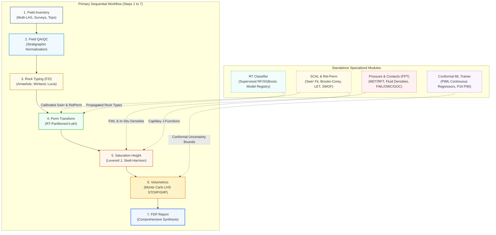
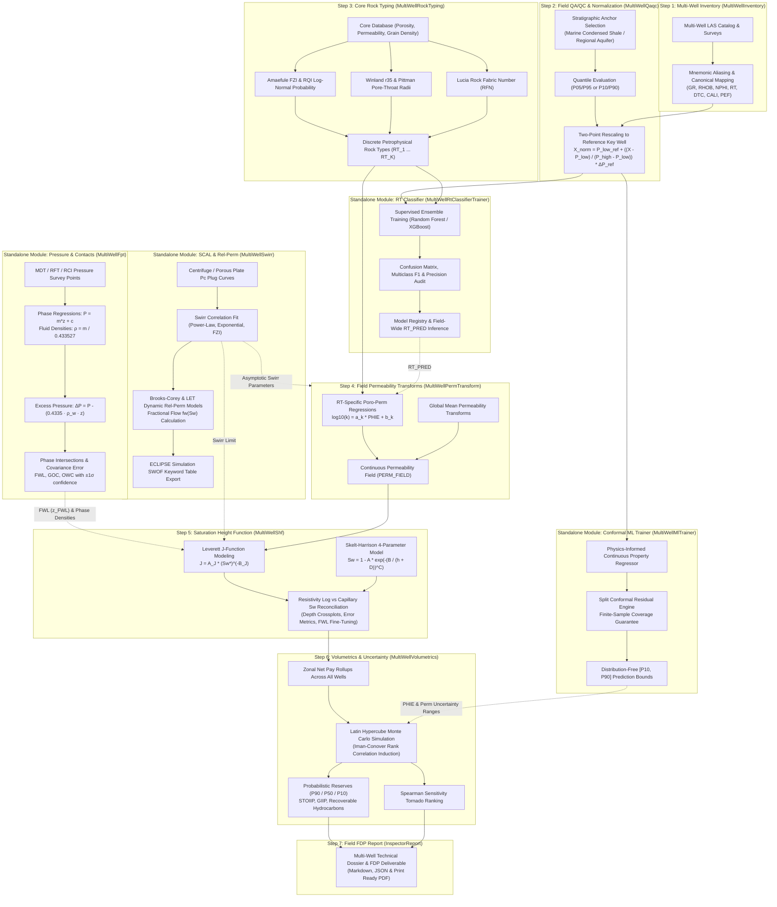
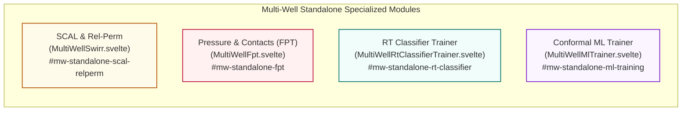

# Multi-Well Field Evaluation Workflow

The Multi-Well workspace harmonizes multi-vintage logging suites across the entire field, establishes consistent stratigraphic baselines, models core-calibrated Petrophysical Rock Types and permeability transforms, calculates field-wide Saturation-Height Functions ($\text{SHF}$), and runs Monte Carlo volumetric uncertainty.

In Field QA/QC, **Missing Data Imputation** uses selected wells and the active depth and zone filters. Mean, median, most frequent, KNN, and iterative models fit pooled samples; KNN scales curves before computing distances. Forward/backward fill follows increasing depth independently within each well. Results are saved as separate `_IMP` curves, leaving original logs unchanged. Existing outputs must be renamed or deleted before re-running, and curves with no observed values across the selected wells cannot be imputed. The right-pane **Missing Matrix** displays one selected well at a time, with deeper depths at the top and colors showing the missing fraction in each depth bin.

The workflow is structured into **7 Primary Sequential Steps** for end-to-end field evaluation, complemented by **4 Standalone Specialized Modules** (SCAL & Dynamic Relative Permeability, Formation Pressure & Contacts, Discrete Rock Type Classifier Trainer, and Conformal Physics-Informed ML Trainer).

---

## 1. Workflow Architecture (Level 1 & Level 2) {#mw-level-1-2-diagrams}

### Level 1: Macro Workflow

High-level progression from field data ingestion to probabilistic reserves, showing the 7 sequential steps and the 4 standalone modules.



### Level 2: Data Flow, Integration & Reconciliation Architecture

Detailed interaction showing how primary steps interact with the standalone modules to produce field-wide petrophysical evaluations.



---

## 2. Primary Sequential Steps (1 to 7)

### Step 1: Multi-Well Inventory & Mnemonic Standardization (`MultiWellInventory`) {#mw-step-1-inventory}

* **Objective:** Ingest heterogeneous well databases, resolve vendor curve mnemonics into canonical families, harmonize physical units, and perform spatial audit of survey, core, top, and pressure tables.

* **Technical Foundation:**
  Enforces deterministic mapping into `quick_pp` canonical curve families:
  
  $$\text{Gamma Ray: } \{\text{GR, CGR, SGR, RGR, GRR}\} \to \text{GR (gAPI)}$$
  
  $$\text{Bulk Density: } \{\text{RHOB, RHOZ, ZDEN, DEN, RHO8}\} \to \text{RHOB (g/cm}^3)$$
  
  $$\text{Neutron Porosity: } \{\text{NPHI, TNPH, NPOR, CNC, NEU}\} \to \text{NPHI (dec or v/v)}$$
  
  $$\text{Deep Resistivity: } \{\text{RT, RD, ILD, RDEP, AT90, HRLD}\} \to \text{RT (ohm}\cdot\text{m)}$$
  
  $$\text{Compressional Sonic: } \{\text{DTC, DT, DTCO, AC, ITT}\} \to \text{DTC (}\mu\text{s/ft)}$$

* **Input Data:** LAS 2.0/3.0 files, Deviation surveys (MD, Inclination, Azimuth), Formation marker tops.
* **Output Data:** Canonical multi-well data tree, completeness coverage matrix, TVD trajectory grid.

---

### Step 2: Field QA/QC & Stratigraphic Normalization (`MultiWellQaqc`) {#mw-step-2-qaqc}

* **Objective:** Eliminate tool calibration drift, mud salinity variations, and service vendor biases across multi-decade drilling campaigns prior to field-wide rock typing and ML modeling.

* **Technical Foundation:**

    * **Key-Well Reference Marker Distribution:**
      A cored, high-integrity reference well ("Key Well") is selected within a regionally extensive, lithologically stable stratigraphic marker zone (e.g. marine condensed section shale or regional clean aquifer sand) to establish target percentiles $(P_{\text{low}}^{\text{ref}}, P_{\text{high}}^{\text{ref}})$, typically $(P_{05}, P_{95})$ or $(P_{10}, P_{90})$.

    * **Two-Point Quantile Linear Rescaling:**
      For each subject well $w$ with marker percentiles $(P_{\text{low}}^{(w)}, P_{\text{high}}^{(w)})$:
      
      $$X_{w,\text{norm}} = P_{\text{low}}^{\text{ref}} + \left( \frac{X_w - P_{\text{low}}^{(w)}}{P_{\text{high}}^{(w)} - P_{\text{low}}^{(w)}} \right) \cdot \left( P_{\text{high}}^{\text{ref}} - P_{\text{low}}^{\text{ref}} \right)$$

* **Input Data:** Multi-well raw curves, Reference key-well selection, Marker top/base boundaries.
* **Output Data:** `GR_NORM`, `NPHI_NORM`, `RHOB_NORM`, Multi-well quantile diagnostic histograms.

---

### Step 3: Core Rock Typing & Hydraulic Flow Units (`MultiWellRockTyping`) {#mw-step-3-rock-typing}

* **Objective:** Partition core plug measurements into discrete Petrophysical Rock Types ($RT_1, \dots, RT_K$) that share consistent pore-throat size distributions, flow geometry, and capillary behavior.

* **Technical Foundation:**

    * **Hydraulic Flow Units (Amaefule FZI):**
      
      $$\text{RQI} = 0.0314 \sqrt{\frac{k}{\phi_e}}, \qquad \phi_z = \frac{\phi_e}{1 - \phi_e}, \qquad \text{FZI} = \frac{\text{RQI}}{\phi_z}$$
      
      Rock types appear as distinct normal distributions on probability plots of $\log_{10}(\text{FZI})$ or clusters identified via Ward's hierarchical agglomerative clustering.

    * **Winland $r_{35}$ & Pittman Pore-Throat Radii:**
      Pore-throat radius at $35\%$ mercury saturation (apical pore opening):
      
      $$\log_{10}(r_{35}) = 0.732 + 0.588 \log_{10}(k) - 0.864 \log_{10}(\phi_{\%})$$
      
      * **Megaporous:** $r_{35} > 10\,\mu\text{m}$
      * **Macroporous:** $r_{35} \in [2, 10]\,\mu\text{m}$
      * **Mesoporous:** $r_{35} \in [0.5, 2]\,\mu\text{m}$
      * **Microporous:** $r_{35} \in [0.1, 0.5]\,\mu\text{m}$
      * **Nanoporous:** $r_{35} < 0.1\,\mu\text{m}$

    * **Lucia Rock Fabric Number (RFN, Carbonates):**
      Links interparticle porosity ($\phi_{ip}$) and permeability to grain-dominated vs mud-dominated fabrics:
      
      $$\log_{10}(k) = (9.7982 - 12.0838 \log_{10} \text{RFN}) + (8.6711 - 8.2965 \log_{10} \text{RFN}) \log_{10}(\phi_{ip})$$

    * **Modified Lorenz Plot ($F_m$ vs $\Phi_m$):**
      Plots cumulative flow capacity $F_m = \frac{\sum (k \cdot h)_i}{\sum k \cdot h}$ against cumulative storage capacity $\Phi_m = \frac{\sum (\phi \cdot h)_i}{\sum \phi \cdot h}$ to diagnose reservoir heterogeneity and identify high-conductivity thief zones.

* **Input Data:** Core porosity ($\phi_{\text{core}}$), Permeability ($k_{\text{core}}$), Grain density.
* **Output Data:** Core rock type labels ($RT_1, \dots, RT_K$), FZI cutoffs, Winland classes.

---

### Step 4: Field Permeability Transforms (`MultiWellPermTransform`) {#mw-step-4-perm-transform}

* **Objective:** Establish Rock-Type-specific porosity-permeability transforms and generate continuous permeability curves across all field wells.

* **Technical Foundation:**

    * **Rock-Type Partitioned Poro-Perm Regressions:**
      Within each propagated Rock Type $RT_k$:
      
      $$\log_{10}(k) = a_k \cdot \phi_e + b_k \quad \lor \quad k = 1014 \cdot \overline{\text{FZI}}_k^2 \cdot \frac{\phi_e^3}{(1 - \phi_e)^2}$$

    * **Global vs Partitioned Blending:**
      For intervals where rock typing is ambiguous or unclassified, a fallback regression or harmonic mean blending is applied to ensure continuity without unphysical permeability spikes.

* **Input Curves:** `RT_PRED` (from classification) or `FZI_ZONE`, `PHIE`.
* **Output Curves:** `PERM_FIELD` (permeability log populated across all active wells).

---

### Step 5: Saturation-Height Function (SHF) & Reconciliation (`MultiWellShf`) {#mw-step-5-shf}

* **Objective:** Construct a capillary-equilibrium water saturation profile $S_{w,\text{SHF}}(h)$ above the Free Water Level ($\text{FWL}$) and reconcile it with resistivity log saturation ($S_{w,\text{log}}$).

* **Technical Foundation:**

    * **Height Above FWL & Capillary Pressure:**
      
      $$h = \max\left(0, \;\; z_{\text{FWL}} - \text{TVDSS}\right)$$
      
      $$P_{c,\text{res}}(h) = 0.433527 \cdot (\rho_w - \rho_{\text{hc}}) \cdot h \quad (\text{psi})$$

    * **Leverett $J$-Function Model:**
      Collapses multi-rock-type capillary pressure curves into a dimensionless function:
      
      $$J(S_w) = \frac{0.2166 \cdot P_{c,\text{res}}}{\sigma_{\text{res}} \cos\theta_{\text{res}}} \sqrt{\frac{k}{\phi_e}}$$
      
      Fitting the power-law $J = A_J \cdot (S_w^*)^{-B_J}$ (where $S_w^* = \frac{S_w - S_{\text{wirr}}}{1 - S_{\text{wirr}}}$) yields saturation at any elevation:
      
      $$S_{w,\text{SHF}}(h, k, \phi_e) = S_{\text{wirr}} + (1 - S_{\text{wirr}}) \cdot \left( \frac{J(h, k, \phi_e)}{A_J} \right)^{-\frac{1}{B_J}}$$

    * **Skelt-Harrison Analytical Model:**
      Provides a smooth 4-parameter continuous saturation profile:
      
      $$S_{w,\text{SHF}}(h) = 1 - A \cdot \exp\left( - \left( \frac{B}{h + D} \right)^C \right)$$

    * **FWL Inverse Optimization:**
      When pressure survey points are ambiguous, $z_{\text{FWL}}$ and SHF parameters are inverted simultaneously by minimizing the residual against deep resistivity log saturation across all wells:
      
      $$\min_{z_{\text{FWL}}, \mathbf{\theta}_{\text{SHF}}} \sum_{w=1}^{N_w} \sum_{i=1}^{M_w} \left( S_{w,\text{SHF}}(z_{w,i}; z_{\text{FWL}}, \mathbf{\theta}) - S_{w,\text{log},i} \right)^2$$

    * **Fluid Contact & Transition Limits Delineation (`extract_fluid_contacts_and_limits`):**
      Automatically establishes petrophysical fluid boundaries across all wells and zones:
      * **Gas Limits & Contacts:** GUT (Gas Up To), GDT (Gas Down To), GOC (Gas-Oil Contact), GWC (Gas-Water Contact)
      * **Oil Limits & Contacts:** OUT (Oil Up To), ODT (Oil Down To), OWC (Oil-Water Contact)
      * **Water Limits & Contacts:** WUT (Water Up To), FWL (Free Water Level) — *Note: WDT (Water Down To) is explicitly excluded as it carries no petrophysical utility.*
      * **Net Sand & Pay Conditioning:** Declared contacts require contiguous reservoir sand samples ($V_{\text{sh}} \le V_{\text{sh,cutoff}}$, $\phi_e \ge \phi_{\text{cutoff}}$, $h_{\text{sand}} \ge 1.0\,\text{m}$) and saturation discrimination ($S_w \le S_{w,\text{pay}}$ for hydrocarbon, $S_w \ge S_{w,\text{water}}$ for water).

* **Input Data:** `TVDSS`, `PERM_FIELD`, `PHIE`, $z_{\text{FWL}}$, In-situ fluid densities ($\rho_w, \rho_{\text{hc}}$).
* **Output Data:** `SW_SHF`, Reconciliation crossplots, Residual error statistics ($\text{RMSE}, R^2$).

---

### Step 6: Probabilistic Field Volumetrics & Uncertainty (`MultiWellVolumetrics`) {#mw-step-6-volumetrics}

* **Objective:** Combine multi-well net-pay distributions, structural geometry, and fluid properties to evaluate P90 (1P/Proven), P50 (2P), and P10 (3P) Hydrocarbons Initially In Place (STOIIP / GIIP) and identify primary subsurface risks.

* **Technical Foundation:**

    * **Governing Volumetric Equations:**
      
      $$\text{STOIIP (bbl)} = \frac{7758 \cdot A \cdot H_{\text{gross}} \cdot \text{NTG} \cdot \phi_e \cdot (1 - S_w)}{B_o}$$
      
      $$\text{GIIP (scf)} = \frac{43560 \cdot A \cdot H_{\text{gross}} \cdot \text{NTG} \cdot \phi_e \cdot (1 - S_w)}{B_g}$$
      
      $$\text{Metric (m}^3\text{): } V = \frac{10^6 \cdot A_{\text{km}^2} \cdot H_{\text{net}} \cdot \phi_e \cdot (1 - S_w)}{B}$$

    * **Monte Carlo / Latin Hypercube Sampling (LHS):**
      Draws $N_{\text{sim}} \ge 10,000$ stratifying samples across distributions (Normal, Log-Normal, Triangular, PERT) for Area, Gross Thickness, NTG, $\phi_e$, $S_w$, and $B_o/B_g$.

    * **Iman-Conover Rank Correlation Induction:**
      Prevents unphysical realizations by enforcing the empirical rank correlation matrix $\mathbf{C}$ (e.g. negative correlation between $\phi_e$ and $S_w$) on the sampled matrix:
      
      $$\mathbf{X}^* = \mathbf{X} \cdot \mathbf{L}^T \quad \text{where } \mathbf{C} = \mathbf{L}\mathbf{L}^T$$

    * **PRMS Oilfield Percentiles & Sensitivity Tornado:**
      Extracts cumulative exceedance percentiles:
      * **P90 (Proven / 1P):** $90\%$ probability that actual volume equals or exceeds this estimate ($Q_{0.10}$)
      * **P50 (Probable / 2P):** Median expectation ($Q_{0.50}$)
      * **P10 (Possible / 3P):** $10\%$ upside expectation ($Q_{0.90}$)
      
      Computes Spearman rank correlation coefficients $\rho_s(\theta_j, \text{STOIIP})$ to generate the Tornado chart ranking uncertainty drivers.

* **Input Data:** Zonal summaries across all wells, Structural area distributions, Fluid PVT ($B_o, B_g$).
* **Output Data:** P90/P50/P10 STOIIP & GIIP, Cumulative exceedance curves, Tornado sensitivity chart.

---

### Step 7: Field FDP Report (`InspectorReport` / Multi-Well Dossier) {#mw-step-7-report}

* **Objective:** Synthesize multi-well data inventory, stratigraphic normalization results, pressure gradients, rock typing distributions, SHF models, and probabilistic volumetric reserve estimates into an executive Field Development Plan (FDP) report.

* **Technical Foundation:**
  Automated multi-well dossier compilation featuring executive summaries, zonal net pay rollups, fluid contact determinations, and volumetric risk distributions in Markdown, JSON, and print-ready PDF formats.

---

## 3. Standalone Specialized Modules

The Multi-Well workspace provides 4 standalone specialized modules accessible at any point during field evaluation.



---

### Standalone Module 1: SCAL & Dynamic Relative Permeability (`MultiWellSwirr`) {#mw-standalone-scal-relperm}

* **Objective:** Ingest field-wide Special Core Analysis ($\text{SCAL}$) capillary pressure plug experiments, fit irreducible water saturation ($S_{\text{wirr}}$) correlations, model dynamic Relative Permeability ($k_r$) curves, compute fractional flow ($f_w$), and export ECLIPSE simulation `SWOF` keyword decks.

* **Technical Foundation:**

    * **Multi-Well $S_{\text{wirr}}$ Extraction & Correlation:**
      Extracts $S_{\text{wirr}}$ from porous plate, centrifuge, or MICP capillary pressure curves at a designated reservoir displacement threshold pressure $P_{c,\text{threshold}}$ (e.g. $100\,\text{psi}$).
      
      Fits parametric regressions across plugs globally and by Petrophysical Rock Type ($RT$):
      * **Power-Law Permeability / Porosity Model:**
        $$S_{\text{wirr}} = c_1 \cdot \phi_e^{c_2} \cdot k^{c_3}$$
      * **FZI Hydraulic Flow Unit Model:**
        $$S_{\text{wirr}} = 1 - \frac{1}{a_{\text{FZI}} + b_{\text{FZI}} \cdot \text{FZI}^{-c_{\text{FZI}}}}$$
      * **Logarithmic / Polynomial Fits:**
        $$S_{\text{wirr}} = a \cdot \ln(k) + b$$

    * **Normalized Effective Phase Saturation:**
      
      $$S_{wn} = \frac{S_w - S_{\text{wirr}}}{1 - S_{\text{wirr}} - S_{or}}$$

    * **Dynamic Relative Permeability Models:**
      * **Brooks-Corey Model:**
        $$k_{rw}(S_{wn}) = k_{rw,\max} \cdot S_{wn}^{n_w}$$
        $$k_{ro}(S_{wn}) = k_{ro,\max} \cdot (1 - S_{wn})^{n_o}$$
      * **Modified Corey Formulation:**
        Accounts for pore-size distribution index $\lambda$:
        $$n_w = \frac{2 + 3\lambda}{\lambda}, \qquad n_o = 2 + \lambda$$
      * **LET Model (Lomeland, Ebeltoft, Thomas):**
        Provides flexible S-shaped relative permeability curves without artificial end-point artifacts:
        $$k_{rw}(S_{wn}) = k_{rw,\max} \cdot \frac{S_{wn}^{L_w}}{S_{wn}^{L_w} + E_w (1 - S_{wn})^{T_w}}$$
        $$k_{ro}(S_{wn}) = k_{ro,\max} \cdot \frac{(1 - S_{wn})^{L_o}}{(1 - S_{wn})^{L_o} + E_o S_{wn}^{T_o}}$$
        where $L$ governs the lower slope/entry, $E$ elevates the central plateau, and $T$ governs the upper approach to the end-point.

    * **Fractional Flow Curve ($f_w$):**
      Calculates the fractional water cut as a function of water saturation and oil/water viscosity ratio $M = \frac{\mu_o}{\mu_w}$:
      
      $$f_w(S_w) = \frac{1}{1 + \left(\frac{k_{ro}(S_w)}{k_{rw}(S_w)}\right) \cdot \left(\frac{\mu_w}{\mu_o}\right)}$$

    * **Reservoir Simulation Export (ECLIPSE `SWOF` Deck):**
      Formats monotonic tables of $(S_w, k_{rw}, k_{row}, P_{cow})$ with automated end-point validation conforming to ECLIPSE and CMG black-oil simulator syntax:
      
      ```text
      -- ECLIPSE 100 / 300 RELPERM & CAPILLARY TABLE
      SWOF
      -- Sw      Krw       Krow      Pcow (psi)
         0.150   0.00000   0.85000   150.00
         0.200   0.00125   0.72410    45.20
         ...
         0.800   0.35000   0.00000     0.00
      /
      ```

* **Input Data:** SCAL capillary pressure curves, Reservoir endpoint parameters ($S_{\text{wirr}}, S_{or}, k_{rw,\max}, k_{ro,\max}$), Fluid viscosities ($\mu_o, \mu_w$).
* **Output Data:** Fitted $S_{\text{wirr}}$ models, Relative permeability tables, Fractional flow diagnostic plots, Formatted `SWOF` text decks.

---

### Standalone Module 2: Formation Pressure Testing (FPT) & Fluid Contacts (`MultiWellFpt`) {#mw-standalone-fpt}

* **Objective:** Determine in-situ fluid phase pressure gradients, calculate in-situ fluid densities ($\rho_g, \rho_o, \rho_w$), identify hydraulic communication across fault blocks, and calculate the Free Water Level ($\text{FWL}$), Gas-Oil Contact ($\text{GOC}$), and producible contacts ($\text{OWC}, \text{GWC}$) with covariance uncertainty bounds.

* **Technical Foundation:**

    * **Hydrostatic Phase Linear Regression:**
      In each mobile phase $p \in \{\text{gas, oil, water}\}$, pressure $P$ varies linearly with depth $z = \text{TVDSS}$:
      
      $$P_p(z) = m_p \cdot z + c_p$$
      
      where the gradient $m_p = \frac{dP_p}{dz}$ (in $\text{psi/ft}$) is converted to in-situ fluid density $\rho_p$ (in $\text{g/cm}^3$):
      
      $$\rho_p = \frac{m_p}{0.433527}$$

    * **Diagnostic Excess Pressure:**
      Identifies pressure regime anomalies (supercharging, drawdown, depleted reservoirs):
      
      $$P_{\text{excess}}(z) = P(z) - \left( 0.433527 \cdot \rho_{\text{water,datum}} \cdot z \right)$$

    * **Equilibrium Fluid Contact Intersection Mathematics:**
      Phase contacts occur at the exact intersection of phase lines ($P_c = P_{\text{non-wet}} - P_{\text{wet}} = 0$):
      
      $$\text{FWL (Oil-Water): } z_{\text{FWL}} = \frac{c_w - c_o}{m_o - m_w}$$
      
      $$\text{GOC (Gas-Oil): } z_{\text{GOC}} = \frac{c_o - c_g}{m_g - m_o}$$
      
      $$\text{GWC (Gas-Water): } z_{\text{GWC}} = \frac{c_w - c_g}{m_g - m_w}$$

    * **Contact Uncertainty Propagation:**
      Using the covariance matrix $\boldsymbol{\Sigma}_{(m, c)}$ from least-squares regression, the contact depth variance is:
      
      $$\sigma_{z_{\text{contact}}}^2 = \mathbf{J} \cdot \boldsymbol{\Sigma} \cdot \mathbf{J}^T \quad \text{where } \mathbf{J} = \left[ \frac{\partial z}{\partial m_1}, \frac{\partial z}{\partial c_1}, \frac{\partial z}{\partial m_2}, \frac{\partial z}{\partial c_2} \right]$$

    * **Displacement Threshold Offset (OWC vs FWL):**
      In rocks with non-zero entry capillary pressure $P_d$, the producible Oil-Water Contact ($\text{OWC}$) sits above the $\text{FWL}$ by:
      
      $$z_{\text{OWC}} = z_{\text{FWL}} - \frac{P_{d,\text{res}}}{0.433527 \cdot (\rho_w - \rho_o)}$$

* **Input Data:** MDT / RFT / RCI pressure survey table $(\text{TVDSS}, P_{\text{form}}, \text{QualityFlag})$.
* **Output Data:** Fluid gradients ($m_g, m_o, m_w$), In-situ densities ($\rho_g, \rho_o, \rho_w$), Contact depths ($z_{\text{FWL}}, z_{\text{GOC}}, z_{\text{OWC}}$) $\pm \sigma$.

---

### Standalone Module 3: Supervised Petrophysical Rock Type (DRT) Classifier (`MultiWellRtClassifierTrainer`) {#mw-standalone-rt-classifier}

* **Objective:** Train supervised machine learning models on cored Key Wells to predict discrete Petrophysical Rock Types across uncored field wells, validating performance via cross-validation and confusion matrices.

* **Technical Foundation:**

    * **Multi-Scale Feature Engineering:**
      Extracts feature vectors from normalized log curves:
      * Normalized primary curves: $\text{GR\_NORM}, \text{RHOB\_NORM}, \text{NPHI\_NORM}, \text{RT}, \text{DTC}$
      * Mineral indicators: Apparent acoustic impedance surrogate $\text{AI} = \text{RHOB} \cdot (10^6 / \text{DTC})$
      * Porosity separation: $\Delta \phi_{ND} = \text{NPHI} - \phi_D$
      * Multi-scale rolling standard deviations and vertical gradients ($\pm 1\,\text{m}, \pm 3\,\text{m}$) to capture bed boundary transitions.

    * **Classifier Architectures:**
      * **Random Forest Classifier:** Ensembles decorrelated decision trees with out-of-bag (OOB) validation.
      * **Gradient Boosting (XGBoost / LightGBM):** Minimizes multiclass log-loss with regularization against overfitting.

    * **Model Diagnostics & Registry:**
      * Stratified k-fold cross-validation
      * Multi-class confusion/contingency matrix, precision, recall, and Macro-F1 scores
      * Model persistence into the project registry for on-demand inference across any uncored well.

* **Input Data:** Normalized logs on cored Key Wells, Core Rock Type labels ($RT_1, \dots, RT_K$).
* **Output Data:** Trained classifier artifact, feature importance ranking, predicted rock type curves (`RT_PRED`).

---

### Standalone Module 4: Conformal Physics-Informed ML Trainer (`MultiWellMlTrainer`) {#mw-standalone-ml-training}

* **Objective:** Train continuous petrophysical property regressors ($\phi_e, k, S_w$) regularized with physical constraints, generating distribution-free P10–P90 uncertainty prediction intervals via conformal prediction.

* **Technical Foundation:**

    * **Physics-Informed Machine Learning (PIML) Regularization:**
      Enforces physical domain laws during model training:
      * **Strict Monotonicity:** $\frac{\partial k}{\partial \phi_e} \ge 0$, $\frac{\partial k}{\partial V_{\text{clay}}} \le 0$
      * **Physical Bounds:** $\phi_e \in [0, \phi_{\max}]$, $S_w \in [S_{\text{wirr}}, 1.0]$.
      * **Physics Loss Penalty:**
        $$\mathcal{L}_{\text{total}} = \mathcal{L}_{\text{MSE}} + \lambda_{\text{phys}} \sum \max\left(0, -\frac{\partial \hat{y}}{\partial x_{\text{phys}}}\right)$$

    * **Split Conformal Prediction Engine (Distribution-Free Coverage Guarantee):**
      Given calibration samples $\mathcal{D}_{\text{cal}} = \{(\mathbf{x}_i, y_i)\}_{i=1}^n$, computes absolute non-conformity scores:
      
      $$s_i = |y_i - \hat{f}(\mathbf{x}_i)|$$
      
      For target error rate $\alpha$ (e.g. $\alpha = 0.10$ for $90\%$ confidence), the empirical quantile $\hat{q}_{1-\alpha}$ defines prediction intervals on uncored wells:
      
      $$\hat{q}_{1-\alpha} = \text{Quantile}\left( \{s_i\}_{i=1}^n, \;\; \frac{\lceil(n+1)(1-\alpha)\rceil}{n} \right)$$
      
      $$\mathcal{C}(\mathbf{x}_{\text{new}}) = \left[ \hat{f}(\mathbf{x}_{\text{new}}) - \hat{q}_{1-\alpha}, \;\; \hat{f}(\mathbf{x}_{\text{new}}) + \hat{q}_{1-\alpha} \right]$$
      
      Guarantees marginal coverage $\mathbb{P}\left(Y_{\text{new}} \in \mathcal{C}(\mathbf{X}_{\text{new}})\right) \ge 1 - \alpha$ without parametric Gaussian assumptions.

* **Input Data:** Multi-well normalized logs, Core calibration target properties.
* **Output Data:** Continuous prediction curves with rigorous $[\text{P10}, \text{P90}]$ conformal prediction bands.
