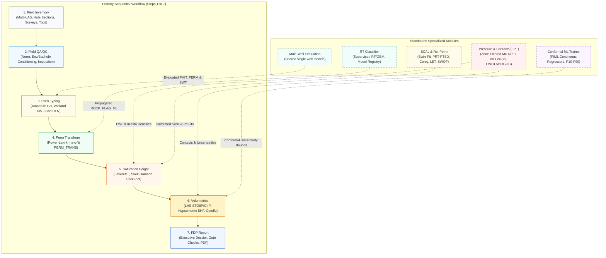
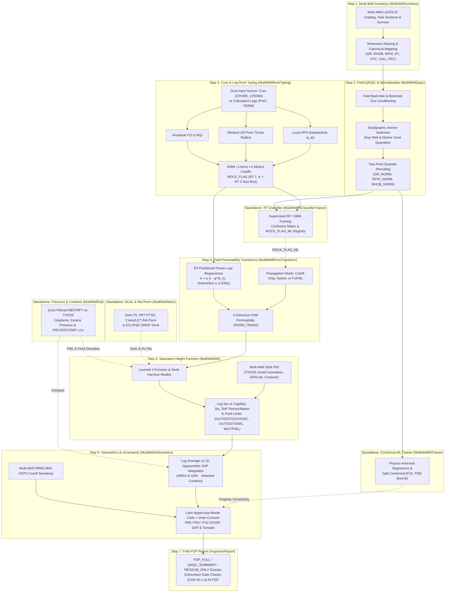
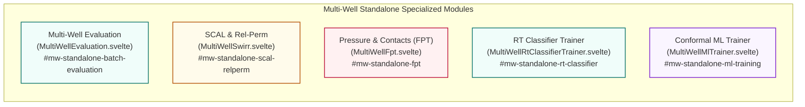

# Multi-Well Field Evaluation Workflow

The Multi-Well workspace harmonizes multi-vintage logging suites across the entire field, establishes consistent stratigraphic baselines, models discrete Petrophysical Rock Types (`ROCK_FLAG`) and power-law permeability transforms (`PERM_TRANS`), calculates field-wide Saturation-Height Functions ($\text{SHF}$), and runs probabilistic Monte Carlo volumetric uncertainty.

In Field QA/QC, **Missing Data Imputation** uses selected wells and the active depth and zone filters. Mean, median, most frequent, KNN, and iterative models fit pooled samples; KNN scales curves before computing distances. Forward/backward fill and depth-based linear interpolation operate independently within each well; interpolation leaves end gaps missing. Results are saved as separate `_IMP` curves by default. Alternatively, replace existing curves while preserving a full-well `_ORI` backup; existing backups are never overwritten. Replacement requires the source curve to exist in every selected well. Existing `_IMP` outputs must be renamed or deleted before re-running in new-curve mode, and curves with no observed values across the selected wells cannot be imputed. The right-pane **Missing Matrix** displays one selected well at a time, with deeper depths at the top and colors showing the missing fraction in each depth bin.

The workflow is structured into **7 Primary Sequential Steps** for end-to-end field evaluation, complemented by **5 Standalone Specialized Modules** (Multi-Well Evaluation, SCAL & Dynamic Relative Permeability, Formation Pressure & Contacts, Discrete Rock Type Classifier Trainer, and Conformal Physics-Informed ML Trainer). Project-scoped module parameters and curves persist seamlessly into `.qpp` Handover Packages.

---

## 1. Workflow Architecture (Level 1 & Level 2) {#mw-level-1-2-diagrams}

#### Level 1: Macro Workflow

High-level progression from field data ingestion to probabilistic reserves, showing the 7 sequential steps and the 5 standalone modules.

#### Level 2: Data Flow, Integration & Reconciliation Architecture

Detailed interaction showing how primary steps interact with the standalone modules to produce field-wide petrophysical evaluations.

---

## 2. Primary Sequential Steps (1 to 7)

### Step 1: Multi-Well Inventory & Mnemonic Standardization (`MultiWellInventory`) {#mw-step-1-inventory}

* **Objective:** Ingest heterogeneous well databases, resolve vendor curve mnemonics into canonical families, harmonize physical units, and perform a field-wide spatial and completeness audit across log suites, Hole Sections, surveys, tops, core, SCAL, and pressure tables.

* **Technical Foundation:**
  Enforces deterministic mapping into `quick_pp` canonical curve families:
  
  $$\text{Gamma Ray: } \{\text{GR, CGR, SGR, RGR, GRR}\} \to \text{GR (gAPI)}$$
  
  $$\text{Bulk Density: } \{\text{RHOB, RHOZ, ZDEN, DEN, RHO8}\} \to \text{RHOB (g/cm}^3)$$
  
  $$\text{Neutron Porosity: } \{\text{NPHI, TNPH, NPOR, CNC, NEU}\} \to \text{NPHI (dec or v/v)}$$
  
  $$\text{Deep Resistivity: } \{\text{RT, RD, ILD, RDEP, AT90, HRLD}\} \to \text{RT (ohm}\cdot\text{m)}$$
  
  $$\text{Compressional Sonic: } \{\text{DTC, DT, DTCO, AC, ITT}\} \to \text{DTC (}\mu\text{s/ft)}$$

* **Input Data:** Bulk LAS 2.0/3.0, DLIS & LIS79 files, Hole Sections, Deviation surveys (`MD`, `INC`, `AZI`), Formation tops, Core/SCAL/FPT CSVs, or `.qpp` Handover Packages.
* **Output Data:** Canonical multi-well data tree, completeness coverage matrix, `TVD`/`TVDSS` trajectory grids.

---

### Step 2: Field QA/QC & Stratigraphic Normalization (`MultiWellQaqc`) {#mw-step-2-qaqc}

* **Objective:** Harmonize borehole conditioning across project wells and eliminate tool calibration drift, mud salinity variations, and service vendor biases across multi-decade drilling campaigns prior to field-wide rock typing and ML modeling.

* **Technical Foundation:**

    * **Multi-Well Bad-Hole Flagging & Borehole Environmental Conditioning:**
      Executes batch bad-hole detection (`BADHOLE`, `BS`, `DCALI` honoring per-well Hole Sections), generic `WL`/`LWD` borehole environmental and radial invasion corrections (`*_ENV_CORR`, `*_SIGMA`, `*_QC_CONF`), and pooled/per-well missing-data imputation across selected field wells.

    * **Key-Well Reference Marker Distribution:**
      A cored, high-integrity reference well ("Key Well") is selected within a regionally extensive, lithologically stable stratigraphic marker zone (e.g., marine condensed shale or regional clean aquifer sand) to establish target percentiles $(P_{\text{low}}^{\text{ref}}, P_{\text{high}}^{\text{ref}})$, typically $(P_{05}, P_{95})$ or $(P_{10}, P_{90})$.

    * **Two-Point Quantile Linear Rescaling:**
      For each subject well $w$ with marker percentiles $(P_{\text{low}}^{(w)}, P_{\text{high}}^{(w)})$:
      
      $$X_{w,\text{norm}} = P_{\text{low}}^{\text{ref}} + \left( \frac{X_w - P_{\text{low}}^{(w)}}{P_{\text{high}}^{(w)} - P_{\text{low}}^{(w)}} \right) \cdot \left( P_{\text{high}}^{\text{ref}} - P_{\text{low}}^{\text{ref}} \right)$$

* **Input Data:** Multi-well raw curves, Hole Sections, Reference key-well selection, Stratigraphic marker zones.
* **Output Data:** `GR_NORM`, `NPHI_NORM`, `RHOB_NORM`, field-wide `BADHOLE` & `*_ENV_CORR` curves, `*_IMP` imputed logs, multi-well quantile diagnostic distributions.

---

### Step 3: Core & Log Rock Typing & Hydraulic Flow Units (`MultiWellRockTyping`) {#mw-step-3-rock-typing}

* **Objective:** Partition multi-well **Core Plugs (`CPORE`, `CPERM`)** or **Calculated Logs (`PHIT`, `PERM`)** into discrete Petrophysical Rock Types (`ROCK_FLAG`: $RT_1, \dots, RT_K$ plus optional $RT_0$ Non-Reservoir) that share consistent pore-throat geometry and flow behavior.

* **Technical Foundation:**

    * **Hydraulic Flow Units — Amaefule FZI / RQI (`fzi`):**
      
      $$\text{RQI} = 0.0314 \sqrt{\frac{k}{\phi}}, \qquad \phi_z = \frac{\phi}{1 - \phi}, \qquad \text{FZI} = \frac{\text{RQI}}{\phi_z}$$
      
      Rearranging yields the Kozeny-Carman hydraulic unit permeability relation $k = 1014 \cdot \text{FZI}^2 \cdot \frac{\phi^3}{(1 - \phi)^2}$. Distinct flow units manifest as log-normal populations of $\log_{10}(\text{FZI})$.

    * **Winland $r_{35}$ Pore-Throat Radius (`winland`):**
      Estimates pore-throat radius ($\mu\text{m}$) at 35% mercury saturation from permeability (mD) and porosity percentage ($100\phi$):
      
      $$\log_{10}(r_{35}) = 0.732 + 0.588 \log_{10}(k) - 0.864 \log_{10}(100\phi)$$
      
      Classifies pore systems into Megaporous ($>10\,\mu\text{m}$), Macroporous ($2\text{–}10\,\mu\text{m}$), Mesoporous ($0.5\text{–}2\,\mu\text{m}$), Microporous ($0.1\text{–}0.5\,\mu\text{m}$), and Nanoporous ($<0.1\,\mu\text{m}$).

    * **Lucia Rock Fabric Number — Carbonates (`lucia`):**
      Links interparticle porosity ($\phi_{ip} = \phi_t - \phi_{\text{sec}}$, stripped via sonic Wyllie porosity when available) and permeability to grain-dominated vs. mud-dominated carbonate fabrics ($\text{RFN} \in [0.5, 4.0]$, where lower $\text{RFN}$ indicates superior rock quality):
      
      $$\log_{10}(k) = (9.7982 - 12.0838 \log_{10} \text{RFN}) + (8.6711 - 8.2965 \log_{10} \text{RFN}) \log_{10}(\phi_{ip})$$
      
      Supports automatic Lucia RFN override in carbonate-dominated intervals (`VCALC + VDOLO`).

    * **Automated Cutoff Discovery & Non-Reservoir Isolation (`ROCK_FLAG = 0`):**
      Discovers optimal rock-type boundaries via **Gaussian Mixture Models (`GMM`)** with BIC/AIC cluster selection, **Modified Lorenz Plot** ($F_m = \frac{\sum k_i h_i}{\sum k h}$ vs. $\Phi_m = \frac{\sum \phi_i h_i}{\sum \phi h}$) inflection segmentation, or **K-Means**. Optionally isolates tight/shaly/coal intervals (`PHIT`, `VSHALE`, `PERM` cutoffs & `COAL_FLAG`) into `ROCK_FLAG = 0` so non-reservoir rock does not distort reservoir poro-perm regressions.

* **Input Data:** Multi-well Core (`CPORE`, `CPERM`) or Calculated Logs (`PHIT`, `PERM`), optional Sonic (`DTC`) and Carbonate volumes.
* **Output Data:** `ROCK_FLAG` ($0, 1, \dots, K$), `FZI`, `R35`, `RFN`, GMM/Lorenz cutoffs, synchronized SCAL plug rock-type tags.

---

### Step 4: Field Permeability Transforms (`MultiWellPermTransform`) {#mw-step-4-perm-transform}

* **Objective:** Fit Rock-Type-partitioned power-law porosity-permeability regressions across cored or evaluated wells and apply them across all project wells to generate the continuous **`PERM_TRANS`** curve.

* **Technical Foundation (`workspace_perm_transform_compute`):**

    * **Rock-Type Partitioned Power-Law Regressions:**
      Within each reservoir Discrete Rock Type ($RT_k$, `ROCK_FLAG >= 1`), fits a log-log linear (power-law) relationship on either **Core Data (`CPORE`, `CPERM`)** or **Calculated Logs (`PHIT`, `PERM`)**:
      
      $$k = a_k \cdot \phi^{b_k} \quad \Longleftrightarrow \quad \log_{10}(k) = b_k \log_{10}(\phi) + \log_{10}(a_k)$$
      
      Coefficients $a_k$ and exponents $b_k$ can be interactively edited per DRT in the workbench with live $R^2$ recalculation, crossplot line updates, and Track 5 previewing.

    * **Rock-Flag Propagation & Non-Reservoir Handling:**
      Applies fitted equations to continuous well porosity (`PHIT`) using the selected rock-flag source (`cutoff_only`, `hybrid` core + ML classifier, or `full_ml` from `ROCK_FLAG_ML`). Intervals flagged as non-reservoir (`ROCK_FLAG = 0`) are masked so tight shales and coals do not receive unphysical permeability extrapolations. Downstream modules (Single-Well Reservoir Summary, Multi-Well SHF, Volumetrics, and Reports) automatically prioritize `PERM_TRANS` when saved.

* **Input Curves:** `ROCK_FLAG` / `ROCK_FLAG_ML`, Core (`CPORE`, `CPERM`) or Logs (`PHIT`, `PERM`).
* **Output Curves:** `PERM_TRANS` (continuous field-calibrated permeability in mD saved across project wells), per-RT power-law coefficients $(a_k, b_k, R^2)$.

---

### Step 5: Saturation-Height Function (SHF) & Reconciliation (`MultiWellShf`) {#mw-step-5-shf}

* **Objective:** Construct a capillary-equilibrium water saturation profile $S_{w,\text{SHF}}(h)$ above the Free Water Level ($\text{FWL}$), correlate fluid contacts across wells on the **Multi-Well Stick Plot**, and reconcile capillary saturation against resistivity log saturation ($S_{w,\text{log}}$). Requires true `TVD` / `TVDSS` (`TVD` is never assumed equal to `MD`).

* **Technical Foundation:**

    * **Height Above FWL & Capillary Pressure:**
      Supports global $z_{\text{FWL}}$ or per-zone `fwlByZone`:
      
      $$h = \max\left(0, \;\; z_{\text{FWL}} - \text{TVDSS}\right), \qquad P_{c,\text{res}}(h) = 0.433527 \cdot (\rho_w - \rho_{\text{hc}}) \cdot h \quad (\text{psi})$$

    * **Leverett $J$-Function Model:**
      Collapses multi-rock-type capillary pressure curves into a dimensionless function using `PERM_TRANS` (or `PERM`) and porosity:
      
      $$J(S_w) = \frac{0.2166 \cdot P_{c,\text{res}}}{\sigma_{\text{res}} \cos\theta_{\text{res}}} \sqrt{\frac{k}{\phi}}$$
      
      Fitting the power-law $J = A_J \cdot (S_w^*)^{-B_J}$ (where $S_w^* = \frac{S_w - S_{\text{wirr}}}{1 - S_{\text{wirr}}}$) yields continuous saturation at any structural elevation, with fitted $P_c$/$J$ parameters persisted to the project configuration:
      
      $$S_{w,\text{SHF}}(h, k, \phi) = S_{\text{wirr}} + (1 - S_{\text{wirr}}) \cdot \left( \frac{J(h, k, \phi)}{A_J} \right)^{-\frac{1}{B_J}}$$

    * **Skelt-Harrison Analytical Model & FWL Inverse Optimization:**
      Provides a smooth 4-parameter saturation-height profile $S_{w,\text{SHF}}(h) = 1 - A \cdot \exp\!\left( - \left( \frac{B}{h + D} \right)^C \right)$ and nonlinear least-squares optimization (`workspace_optimize_fwl`) to invert $z_{\text{FWL}}$ against deep-resistivity log saturations across wells.

    * **Multi-Well Stick Plot & Fluid Contact / Limits Delineation (`extract_fluid_contacts_and_limits`):**
      Displays multi-well `TVDSS` structural stick tracks with stratigraphic zone correlation lines, optional `GR` and `COAL` lithology tracks, rich hover inspection readouts, and fluid contact markers:
      * **Gas Limits & Contacts:** `GUT` (Gas Up To), `GDT` (Gas Down To), `GOC` (Gas-Oil Contact), `GWC` (Gas-Water Contact)
      * **Oil Limits & Contacts:** `OUT` (Oil Up To), `ODT` (Oil Down To), `OWC` (Oil-Water Contact)
      * **Water Limits & Contacts:** `WUT` (Water Up To), `FWL` (Free Water Level) — *`WDT` is excluded as petrophysically uninformative.*

* **Input Data:** `TVDSS`, `PERM_TRANS`/`PERM`, `PHIT`/`PHIE`, `SWT`, `FLUID_TYPE`, $z_{\text{FWL}}$ (global or per-zone), In-situ fluid densities ($\rho_w, \rho_{\text{hc}}$).
* **Output Data:** `SW_SHF`, Persisted fluid contacts & limits table, Stick Plot structural correlation, Reconciliation crossplots & error metrics ($\text{RMSE}, R^2$).

---

### Step 6: Probabilistic Field Volumetrics & Uncertainty (`MultiWellVolumetrics`) {#mw-step-6-volumetrics}

* **Objective:** Integrate multi-well zonal net-pay properties, inherited or custom fluid contacts (`FWL`, `OWC`, `GOC`, `GWC`), structural geometry (`AREA` or `GRV`), and PVT distributions in a correlated Latin Hypercube Sampling ($\text{LHS}$) Monte Carlo simulation to quantify PRMS P90 (1P), P50 (2P), and P10 (3P) Oil & Gas In Place and Recoverable Reserves.

* **Technical Foundation:**

    * **Multi-Well Empirical Cutoff Sensitivity (`workspace_multi_well_cutoffs_sensitivity`):**
      Pools evaluated logs across selected project wells and zones to sweep $V_{\text{sh}}$, $\phi_t$, and $S_{wt}$ cutoffs against cumulative $\text{HCPV}$ recovery (default 95% PRMS threshold) before volumetric rollup.

    * **Governing Volumetric Equations (`AREA` vs. `GRV` Modes):**
      Supports Oil (`STOIIP`, Recoverable Oil via $RF_o$), Free Gas (`GIIP`, Recoverable Gas via $RF_g$), and Associated Solution Gas ($R_s$):
      
      $$\text{STOIIP (bbl)} = \frac{7758 \cdot A_{\text{acres}} \cdot H_{\text{gross,ft}} \cdot \text{NTG} \cdot \phi \cdot (1 - S_w)}{B_o}$$
      
      $$\text{GIIP (scf)} = \frac{43560 \cdot A_{\text{acres}} \cdot H_{\text{gross,ft}} \cdot \text{NTG} \cdot \phi \cdot (1 - S_w)}{B_g}$$
      
      $$\text{GRV Mode (m}^3\text{): } V_{hc} = \frac{10^6 \cdot \text{GRV}_{10^6\text{m}^3} \cdot \text{NTG} \cdot \phi \cdot (1 - S_w)}{B}$$

    * **Dual Saturation Assessment (`log_average` vs. `shf` 1D Hypsometric Integration):**
      * `log_average`: Samples lumped well-log porosity and pore-volume-weighted saturation distributions partitioned by fluid contacts (`inherit` from Step 5 SHF / FPT database contacts, or `custom` global/zonal overrides).
      * `shf`: Integrates capillary $S_{w,\text{SHF}}(h)$ across structural elevation slices from crest to contact using either a `structural_dome` conical/dome area-depth curve or `well_tracks` multi-well track integration, incorporating `fwl_uncertainty` ($\pm 1\sigma$ m) directly into each LHS realization.

    * **Latin Hypercube Sampling (LHS), Iman-Conover Correlation & PRMS Tornado:**
      Draws $N_{\text{sim}}$ stratified realizations across Normal, Log-Normal, Triangular, or PERT distributions with Iman-Conover Cholesky rank-correlation induction ($\mathbf{X}^* = \mathbf{X}\mathbf{L}^T$, e.g., negative $\phi$–$S_w$ correlation). Extracts PRMS exceedance percentiles—**P90 (1P / Proven)**, **P50 (2P / Probable)**, and **P10 (3P / Possible)**—and Spearman rank-correlation Tornado sensitivity charts.

* **Input Data:** Multi-well curves & cutoffs, Inherited/custom zonal contacts (`OWC`, `GOC`, `GWC`, `FWL`), Zonal `AREA` or `GRV` & PVT distributions ($B_o, B_g, R_s, RF_o, RF_g$), SHF parameters.
* **Output Data:** P90/P50/P10 `STOIIP`, `GIIP`, Associated Gas & Recoverable Reserves by zone and field total, Exceedance S-curves, Tornado sensitivity rankings.

---

### Step 7: Field FDP Report (`InspectorReport` / Multi-Well Dossier) {#mw-step-7-report}

* **Objective:** Synthesize multi-well data inventory, borehole environmental & invasion QC audits, stratigraphic normalization shifts, FZI/Winland/Lucia rock typing, `PERM_TRANS` regressions, FPT pressure gradients, SHF & SCAL models, probabilistic volumetric reserves, cellular upscaling, and peer-review gate checks into an executive Field Development Plan (`FDP`) deliverable.

* **Report Presets & Audit Capabilities:**
  * **Multi-Well Presets:** `FDP_FULL` (complete 10-section Field Development Plan dossier + CPI appendices), `QAQC_SUMMARY` (Executive Summary, Data Inventory & Multi-Well Conditioning/Normalization Audit), and `RESSUM_ONLY` (Executive Summary, Zonal Reservoir Summary, Probabilistic Volumetrics & Upscaling).
  * **Automated Subsurface Gate-Check & Anomaly Remediation Log (`CHK-01`+):** Pre-render and in-report verification matrix auditing borehole conditioning, sensor confidence (`*_QC_CONF`), core parity, contact consistency across FPT/SHF/logs, and volumetric uncertainty bounds, paired with severity-graded remediation actions and paginated A4 PDF export.

---

## 3. Standalone Specialized Modules

The Multi-Well workspace provides 5 standalone specialized modules accessible at any point during field evaluation.

---

### Multi-Well Evaluation (`MultiWellEvaluation`) {#mw-standalone-batch-evaluation}

This optional utility repeats the current single-well lithology, porosity, permeability and
saturation settings independently for selected well/zone pairs. It is not a pooled field
calibration or a required step of the field workflow. Set the desired parameters in the
single-well modules, select wells and named zones, and preview before applying any results.
The left pane shows the selected wells, zones, and parameter template; expand the snapshot
for full settings. The current depth filter and
brushed interval are not used; each zone is resolved in each well.

For each well/zone pair, the backend evaluates optional hydrocarbon or density correction,
lithology, porosity, optional Thomas-Stieber analysis, permeability, and saturation in that
order. Preview calculations are isolated: they do not save curves or alter the well data
used by other evaluations. Zone labels must be available for each selected well, and
duplicate depths prevent reliable evaluation. A run may use only one correction; invaded-zone
correction, continuous apparent fluid density, and crossplot-calibrated $Q_v$ are excluded because they require well-specific inputs.
When a correction is selected, the lithology and porosity settings must use its corrected
logs. Thomas-Stieber settings are required when permeability or saturation requests that
model.

The preview reports failures per well/zone and compares paired valid values for `VCLAY`, `PHIT`,
`PERM` and `SWT`. The right-hand evaluation grid includes coverage and failures; select a
successful well/zone to load its full-resolution existing and preview curves in the center depth tracks.
`PHIT`, `PERM` and `SWT` can be shown together or individually, and `VCLAY` individually. `PERM`
uses a logarithmic track and changes are shown as a median ratio. The separate Reservoir Summary grid shows only an
in-session summary previously calculated for the active single well, not batch-preview
results; it can be stale and must be recomputed after curve changes.
Only checked successful results are applied, with parameter
snapshots saved per zone. Apply saves the previously calculated preview without recalculating,
after checking the input fingerprint against the current well data and settings; if input
data changed, preview again. Preview data is held temporarily in the backend process for 30 minutes and is released on leaving or changing scope. Recompute reservoir summaries and dependent field interpretations after applying results.

---

### Standalone Module 1: SCAL & Dynamic Relative Permeability (`MultiWellSwirr`) {#mw-standalone-scal-relperm}

* **Objective:** Ingest field-wide Special Core Analysis ($\text{SCAL}$) capillary pressure plug experiments (MICP, Porous Plate, Centrifuge), synchronize Petrophysical Rock Type (`PRT`) classifications with Step 3 Rock Typing, fit irreducible water saturation ($S_{\text{wirr}}$) and Leverett $J$/$P_c$ correlations, model dynamic Relative Permeability ($k_r$) curves, compute fractional flow ($f_w$), and export ECLIPSE `SWOF` simulation decks.

* **Technical Foundation:**

    * **Lab-to-Reservoir $P_c$ Conversion & Multi-Well $S_{\text{wirr}}$ Correlation:**
      Converts plug capillary pressures using explicit laboratory test fluid-system parameters ($\sigma_{\text{lab}} \cos\theta_{\text{lab}}$ vs. $\sigma_{\text{res}} \cos\theta_{\text{res}}$, without assuming high-pressure curves $>200\,\text{psi}$ are automatically MICP) and extracts $S_{\text{wirr}}$ at a designated threshold pressure or asymptotic limit. Fits parametric models globally or per Rock Type (`PRT`):
      * **Power-Law Porosity / Permeability Model:** $S_{\text{wirr}} = c_1 \cdot \phi^{c_2} \cdot k^{c_3}$
      * **FZI Hydraulic Flow Unit Model:** $S_{\text{wirr}} = 1 - \frac{1}{a_{\text{FZI}} + b_{\text{FZI}} \cdot \text{FZI}^{-c_{\text{FZI}}}}$
      * **Logarithmic / Polynomial Fits:** $S_{\text{wirr}} = a \cdot \ln(k) + b$
      Applies calibrated continuous `SWIRR` curves across project wells (`workspace_swirr_apply`) and persists $J$/$P_c$ fit parameters for seamless Step 5 SHF consumption.

    * **Normalized Effective Phase Saturation:**
      
      $$S_{wn} = \frac{S_w - S_{\text{wirr}}}{1 - S_{\text{wirr}} - S_{or}}$$

    * **Pore Throat Size Distribution by PRT:** In the right-hand crossplot,
      select **Pore Throat by PRT** to display individual plug curves grouped
      by rock type (`plot_ptsd_by_prt`): Washburn pore-throat radius is
      calculated from reservoir $P_c$, IFT, and contact angle, and the vertical
      axis plots $dS_{wn} / d(\log_{10} R)$. Well, zone, depth, rock-type, and sample-focus filters apply; plugs excluded from fitting remain visible as dotted curves.

    * **Dynamic Relative Permeability Models & Fractional Flow ($f_w$):**
      * **Brooks-Corey & Modified Corey:** $k_{rw} = k_{rw,\max} S_{wn}^{n_w}$, $k_{ro} = k_{ro,\max} (1 - S_{wn})^{n_o}$ (with $n_w = \frac{2+3\lambda}{\lambda}, n_o = 2+\lambda$ for Modified Corey).
      * **LET Model (Lomeland, Ebeltoft, Thomas):**
        $$k_{rw}(S_{wn}) = k_{rw,\max} \cdot \frac{S_{wn}^{L_w}}{S_{wn}^{L_w} + E_w (1 - S_{wn})^{T_w}}, \qquad k_{ro}(S_{wn}) = k_{ro,\max} \cdot \frac{(1 - S_{wn})^{L_o}}{(1 - S_{wn})^{L_o} + E_o S_{wn}^{T_o}}$$
      * **Fractional Flow Curve:** $f_w(S_w) = \left[1 + \frac{k_{ro}(S_w)}{k_{rw}(S_w)} \cdot \frac{\mu_w}{\mu_o}\right]^{-1}$.

    * **Reservoir Simulation Export (ECLIPSE `SWOF` Deck):**
      Formats monotonic validated tables of $(S_w, k_{rw}, k_{row}, P_{cow})$ per Rock Type (`SATNUM`) conforming to ECLIPSE / CMG black-oil simulator syntax.

* **Input Data:** SCAL capillary pressure curves, Rock Type (`PRT`) assignments, Endpoints ($S_{\text{wirr}}, S_{or}, k_{rw,\max}, k_{ro,\max}$), Fluid viscosities ($\mu_o, \mu_w$).
* **Output Data:** Fitted $S_{\text{wirr}}$ & $J$/$P_c$ models, Continuous `SWIRR` well curves, Pore-throat distributions, Relative permeability & fractional flow plots, Formatted `SWOF` decks.

---

### Standalone Module 2: Formation Pressure Testing (FPT) & Fluid Contacts (`MultiWellFpt`) {#mw-standalone-fpt}

* **Objective:** Regress zone-filtered MDT / RFT / RCI formation pressure measurements against true sub-sea elevation (`TVDSS`), determine in-situ phase densities ($\rho_g, \rho_o, \rho_w$), diagnose overpressure or depletion via excess pressure, and locate equilibrium fluid contacts ($\text{FWL}, \text{GOC}, \text{GWC}, \text{OWC}$) with covariance uncertainty bounds.

* **Technical Foundation:**

    * **Hydrostatic Phase Linear Regression on True `TVDSS`:**
      Resolves true `TVDSS` from directional surveys and datum elevations (never inflating `TVDSS` with raw `MD` in deviated wells) and honors active stratigraphic zone filters and persisted per-zone regression settings. In each mobile phase $p \in \{\text{gas, oil, water}\}$:
      
      $$P_p(z) = m_p \cdot z + c_p, \qquad \rho_p = \frac{m_p}{0.433527} \quad (\text{g/cm}^3 \text{ from psi/ft})$$

    * **Diagnostic Excess Pressure:**
      
      $$P_{\text{excess}}(z) = P(z) - \left( 0.433527 \cdot \rho_{\text{water,datum}} \cdot z \right)$$

    * **Equilibrium Fluid Contact Intersections, Covariance Error & OWC Offset:**
      
      $$z_{\text{FWL}} = \frac{c_w - c_o}{m_o - m_w}, \qquad z_{\text{GOC}} = \frac{c_o - c_g}{m_g - m_o}, \qquad z_{\text{GWC}} = \frac{c_w - c_g}{m_g - m_w}$$
      
      $$\sigma_{z_{\text{contact}}}^2 = \mathbf{J} \cdot \boldsymbol{\Sigma}_{(m,c)} \cdot \mathbf{J}^T, \qquad z_{\text{OWC}} = z_{\text{FWL}} - \frac{P_{d,\text{res}}}{0.433527 \cdot (\rho_w - \rho_o)}$$

* **Input Data:** MDT / RFT / RCI pressure survey table (`MD` / `TVDSS`, $P_{\text{form}}$, Fluid/Quality flags, Zone labels).
* **Output Data:** Phase gradients ($m_g, m_o, m_w$), In-situ densities ($\rho_g, \rho_o, \rho_w$), Contact depths ($z_{\text{FWL}}, z_{\text{GOC}}, z_{\text{GWC}}, z_{\text{OWC}}$) $\pm 1\sigma$ persisted for SHF & Volumetrics.

---

### Standalone Module 3: Supervised Petrophysical Rock Type (DRT) Classifier (`MultiWellRtClassifierTrainer`) {#mw-standalone-rt-classifier}

* **Objective:** Train supervised machine learning models on cored Key Wells to predict discrete Petrophysical Rock Types (`ROCK_FLAG_ML`) across uncored field wells, validating performance via cross-validation and contingency/confusion matrices.

* **Technical Foundation:**
  * **Multi-Scale Feature Engineering:** Normalized logs (`GR_NORM`, `RHOB_NORM`, `NPHI_NORM`, `RT`, `DTC`), acoustic impedance surrogate $\text{AI} = \text{RHOB} \cdot (10^6 / \text{DTC})$, neutron-density separation $\Delta\phi_{ND}$, Burke $M$/$N$ indices, and multi-scale rolling standard deviations/gradients ($\pm 1\,\text{m}, \pm 3\,\text{m}$).
  * **Classifier Architectures & Registry:** Random Forest (with OOB error) and Gradient Boosting (XGBoost / LightGBM) evaluated via stratified $k$-fold cross-validation, multiclass confusion matrices, and Macro-F1 scores, saved into the project model registry for field-wide inference into Step 4 `PERM_TRANS`.

* **Input Data:** Normalized logs on cored Key Wells, Core Rock Type labels (`ROCK_FLAG`).
* **Output Data:** Registered classifier model, feature importances, confusion matrix audit, propagated `ROCK_FLAG_ML` curves.

---

### Standalone Module 4: Conformal Physics-Informed ML Trainer (`MultiWellMlTrainer`) {#mw-standalone-ml-training}

* **Objective:** Train continuous petrophysical property regressors ($\phi, k, S_w$) regularized with physical domain constraints, generating distribution-free P10–P90 uncertainty prediction intervals via Split Conformal Prediction.

* **Technical Foundation:**

    * **Physics-Informed Machine Learning (PIML) Regularization:**
      Enforces domain monotonicity ($\frac{\partial k}{\partial \phi} \ge 0$, $\frac{\partial k}{\partial V_{\text{clay}}} \le 0$) and physical clamping ($\phi \in [0, \phi_{\max}]$, $S_w \in [S_{\text{wirr}}, 1.0]$):
      
      $$\mathcal{L}_{\text{total}} = \mathcal{L}_{\text{MSE}} + \lambda_{\text{phys}} \sum \max\left(0, -\frac{\partial \hat{y}}{\partial x_{\text{phys}}}\right)$$

    * **Split Conformal Prediction Engine (Finite-Sample Coverage Guarantee):**
      Computes calibration non-conformity residuals $s_i = |y_i - \hat{f}(\mathbf{x}_i)|$ and empirical quantile $\hat{q}_{1-\alpha} = \operatorname{Quantile}\!\left(\{s_i\}_{i=1}^n, \frac{\lceil(n+1)(1-\alpha)\rceil}{n}\right)$:
      
      $$\mathcal{C}(\mathbf{x}_{\text{new}}) = \left[ \hat{f}(\mathbf{x}_{\text{new}}) - \hat{q}_{1-\alpha}, \;\; \hat{f}(\mathbf{x}_{\text{new}}) + \hat{q}_{1-\alpha} \right], \qquad \mathbb{P}\!\left(Y_{\text{new}} \in \mathcal{C}(\mathbf{X}_{\text{new}})\right) \ge 1 - \alpha$$

* **Input Data:** Multi-well normalized logs, Core or key-well calibration targets.
* **Output Data:** Saved PIML model suites, continuous predicted curves with rigorous $[\text{P10}, \text{P90}]$ conformal uncertainty bands.
