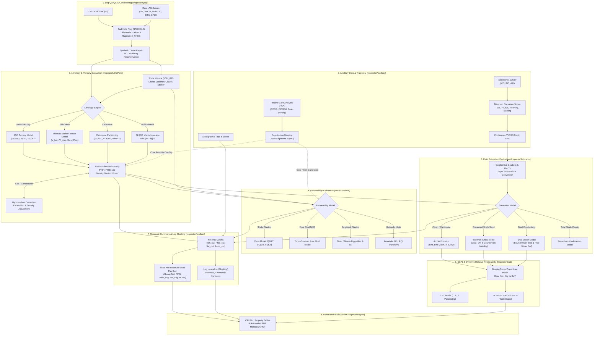

# Single-Well Petrophysical Workflow

The Single-Well space delivers deterministic, optimization-driven, and core-calibrated formation evaluation along a single wellbore trajectory, culminating in a Computer Processed Interpretation (CPI) and automated well dossier.

---

## 1. Workflow Architecture (Level 1 & Level 2) {#sw-level-1-2-diagrams}

### Level 1: Macro Workflow

High-level progression from raw wellbore data conditioning to final reservoir summary and reporting.

```mermaid
flowchart LR
    A["1. Log QA/QC\n(Bad-Hole, Repair, Normalization)"] --> B["2. Ancillary & Core\n(Min. Curvature, Core Ingestion)"]
    B --> C["3. Lithology & Porosity\n(Vsh, SSC, Multi-Mineral, Phie)"]
    C --> D["4. Permeability\n(Choo, Coates, Tixier, FZI)"]
    D --> E["5. Fluid Saturation\n(Archie, Waxman-Smits, Dual Water)"]
    E --> F["6. SCAL & RelPerm\n(Corey, LET, Pc Lab-Res)"]
    F --> G["7. ResSum & Blocking\n(Cutoffs, Net Pay, Upscaling)"]
    G --> H["8. Well CPI Report\n(Automated Dossier, FDP Export)"]

    style A fill:#f0f9ff,stroke:#0284c7,stroke-width:1.5px
    style B fill:#f8fafc,stroke:#475569,stroke-width:1.5px
    style C fill:#f0fdf4,stroke:#16a34a,stroke-width:1.5px
    style D fill:#fefce8,stroke:#ca8a04,stroke-width:1.5px
    style E fill:#fff1f2,stroke:#e11d48,stroke-width:1.5px
    style F fill:#faf5ff,stroke:#9333ea,stroke-width:1.5px
    style G fill:#fef3c7,stroke:#d97706,stroke-width:1.5px
    style H fill:#eff6ff,stroke:#2563eb,stroke-width:2px
```

### Level 2: Sub-Process & Curve Handoff Architecture

Detailed view of curve dependencies, calibration loops, and parameter handoffs between computational modules.

---

## 2. Step-by-Step Technical Foundations

### Step 1: Log QA/QC, Bad-Hole Flagging & Curve Repair (`InspectorQaqc`) {#sw-step-1-qaqc}

* **Objective:** Identify intervals where borehole washout or severe rugosity invalidates shallow-reading pad tools (e.g. $\text{RHOB}, \text{NPHI}, \text{PEF}$), perform environmental corrections, and reconstruct missing or corrupted log intervals using multi-log regressions.

* **Technical Foundation:**

    * **Differential Caliper & Rugosity Flagging:**
      Differential caliper $\Delta \text{CALI} = \text{CALI} - \text{BS}$ measures borehole enlargement relative to bit size. A rolling window of standard deviation $\sigma_{\text{RHOB}}$ evaluates micro-rugosity. The boolean `BADHOLE` flag is triggered if:
      
      $$\Delta \text{CALI} > \tau_{\text{cali}} \quad \lor \quad \sigma_{\text{RHOB}} > \tau_{\sigma} \quad \lor \quad \rho_b < 1.95\,\text{g/cm}^3 \quad \lor \quad \rho_b > 3.05\,\text{g/cm}^3$$

    * **Borehole Environmental Corrections:**
      Mud filtrate invasion, mudcake buildup, and borehole temperature/pressure effects are compensated using analytical functions:
      
      $$\Delta \rho_{\text{mudcake}} = -0.015 \cdot (\text{CALI} - \text{BS}) \cdot \frac{\rho_m - 1.0}{\rho_m}$$

    * **Machine Learning Curve Reconstruction:**
      Corrupted pad readings are reconstructed via multivariate regression or Random Forest models trained on in-gauge intervals ($\text{BADHOLE} = 0$) using deep-reading, borehole-insensitive logs ($\text{GR}, \text{DTC}, \ln(\text{RT})$).

* **Input Curves:** `CALI`, `BS`, `GR`, `RHOB`, `NPHI`, `DTC`, `RT`  
* **Output Curves:** `BADHOLE` (flag), `RHOB_CORR`, `NPHI_CORR`, `GR_CORR`

---

### Step 2: Ancillary Data & Wellbore Trajectory (`InspectorAncillary`) {#sw-step-2-ancillary}

* **Objective:** Establish the True Vertical Depth Sub-Sea ($\text{TVDSS}$) coordinate frame, ingest Routine Core Analysis ($\text{RCA}$) ground truth, and depth-align core samples to wireline logs.

* **Technical Foundation:**

    * **Minimum Curvature Directional Survey Inversion:**
      Converts directional survey stations $(\text{MD}_i, I_i, A_i)$ (Measured Depth, Inclination, Azimuth) into continuous spatial coordinates $(\text{TVD}, N, E)$ using the dogleg angle $\beta_i$ and ratio factor $RF_i$:
      
      $$\beta_i = \arccos\left(\cos I_{i-1} \cos I_i + \sin I_{i-1} \sin I_i \cos(A_i - A_{i-1})\right)$$
      
      $$RF_i = \frac{2}{\beta_i} \tan\left(\frac{\beta_i}{2}\right) \quad (\text{with } RF_i \to 1 \text{ as } \beta_i \to 0)$$
      
      $$\Delta \text{TVD}_i = \frac{\Delta \text{MD}_i}{2} (\cos I_{i-1} + \cos I_i) \cdot RF_i$$
      
      $$\text{TVDSS} = \text{TVD} - \text{KB}$$

    * **Core-to-Log Dynamic Depth Alignment:**
      Core plugs often exhibit systematic depth offsets from wireline cable stretch. Piecewise dynamic time warping ($\text{DTW}$) or maximum cross-correlation aligns core porosity ($\phi_{\text{core}}$) with wireline bulk density ($\rho_b$) or core gamma ray with log $\text{GR}$:
      
      $$\Delta z^*(\text{MD}) = \arg\max_{\Delta z} \int_{z_1}^{z_2} \rho_b(z) \cdot \rho_{\text{grain,core}}(z + \Delta z) \, dz$$

* **Input Data:** Directional survey CSV, RCA core table, Kelly Bushing elevation ($\text{KB}$), Stratigraphic Tops  
* **Output Data:** Continuous `TVD`, `TVDSS`, `DX`, `DY`, `CPOR_SHIFTED`, `CPERM_SHIFTED`

---

### Step 3: Lithology & Porosity Evaluation (`InspectorLithoPoro`) {#sw-step-3-litho-poro}

* **Objective:** Resolve the rock into mineral volumes ($V_{\text{sh}}, V_{\text{sand}}, V_{\text{silt}}, V_{\text{clay}}, V_{\text{calc}}, V_{\text{dolo}}$) and calculate Total Porosity ($\phi_t$) and Effective Porosity ($\phi_e$) corrected for shale and light hydrocarbon effects.

* **Technical Foundation:**

    * **Gamma Ray Index & Empirical $V_{\text{sh}}$ Models:**
      The linear Gamma Ray Index $I_{GR}$ is:
      
      $$I_{GR} = \text{clip}\left(\frac{\text{GR} - \text{GR}_{\text{clean}}}{\text{GR}_{\text{shale}} - \text{GR}_{\text{clean}}}, 0, 1\right)$$
      
      Empirical non-linear transformations account for radioactive mineral variations:
      
      $$\text{Larionov (Tertiary): } V_{\text{sh}} = 0.083 \left( 2^{3.7 \cdot I_{GR}} - 1 \right)$$
      
      $$\text{Larionov (Older / Mesozoic): } V_{\text{sh}} = 0.33 \left( 2^{2 \cdot I_{GR}} - 1 \right)$$
      
      $$\text{Clavier (1971): } V_{\text{sh}} = 1.7 - \sqrt{3.38 - (I_{GR} + 0.7)^2}$$
      
      $$\text{Stieber (1970): } V_{\text{sh}} = \frac{I_{GR}}{3 - 2 \cdot I_{GR}}$$

    * **Sand-Silt-Clay (SSC) Ternary Model:**
      Partitioning resolves the triangle defined by Clean Quartz Sand $(\text{NPHI}_{\text{sd}}, \rho_{\text{sd}})$, Dry Silt $(\text{NPHI}_{\text{slt}}, \rho_{\text{slt}})$, and Dry Clay $(\text{NPHI}_{\text{cl}}, \rho_{\text{cl}})$. The barycentric inversion solves for:
      
      $$V_{\text{sand}} + V_{\text{silt}} + V_{\text{clay}} + \phi_t = 1$$

    * **Thin-Bed Thomas-Stieber & Anisotropic Resistivity:**
      In laminated sand-shale sequences, Thomas-Stieber geometry partitions shale into laminated ($V_{\text{lam}}$), dispersed ($V_{\text{disp}}$), and structural ($V_{\text{struct}}$) forms. Laminated sand conductivity is decoupled from tensor resistivity:
      
      $$R_h^{-1} = \frac{1 - V_{\text{lam}}}{R_{\text{sand}}} + \frac{V_{\text{lam}}}{R_{\text{shale}}}, \qquad R_v = (1 - V_{\text{lam}}) R_{\text{sand}} + V_{\text{lam}} R_{\text{shale}}$$

    * **Multi-Mineral Constrained Optimization (SLSQP):**
      Given $N$ logging measurements $\mathbf{b} = [\text{RHOB}, \text{NPHI}, \text{PEF}, \text{DTC}]^T$ and $M$ mineral components $\mathbf{v} = [V_1, \dots, V_M, \phi_t]^T$:
      
      $$\min_{\mathbf{v}} \sum_{j=1}^N w_j \left( \frac{\sum_{i=1}^M A_{ji} v_i - b_j}{\sigma_j} \right)^2 \quad \text{s.t.} \quad \sum_{i=1}^{M+1} v_i = 1, \quad 0 \le v_i \le 1$$

    * **Total Porosity ($\phi_t$) Formulations:**
      
      $$\text{Density Porosity: } \phi_{D} = \frac{\rho_{\text{ma}} - \rho_b}{\rho_{\text{ma}} - \rho_{\text{fl}}}$$
      
      $$\text{Wyllie Time-Average Sonic: } \phi_S = \frac{\Delta t - \Delta t_{\text{ma}}}{\Delta t_{\text{fl}} - \Delta t_{\text{ma}}} \cdot \frac{1}{B_{cp}}$$
      
      $$\text{Raymer-Hunt-Gardner (RHG): } \phi_{\text{RHG}} = C_{\text{RHG}} \cdot \frac{\Delta t - \Delta t_{\text{ma}}}{\Delta t}$$
      
      $$\text{Neutron-Density Combination: } \phi_{ND} = \sqrt{\frac{\phi_N^2 + \phi_D^2}{2}}$$

    * **Effective Porosity ($\phi_e$) & Clay-Bound Water ($CBW$):**
      
      $$\phi_e = \phi_t - V_{\text{clay}} \cdot \phi_{\text{clay}} \quad \text{or} \quad \phi_e = \phi_t (1 - V_{\text{sh}})$$

    * **Flushed Zone Hydrocarbon Correction:**
      Gas or light condensate lowers $\rho_b$ and suppresses $\text{NPHI}$. The iterative excavation correction adjusts measured curves back to brine-equivalent values prior to porosity calculation.

* **Input Curves:** `GR`, `RHOB`, `NPHI`, `PEF`, `DTC`  
* **Output Curves:** `VSH`, `VSAND`, `VSILT`, `VCLAY`, `VCALC`, `VDOLO`, `PHIT`, `PHIE`

---

### Step 4: Permeability Estimation (`InspectorPerm`) {#sw-step-4-perm}

* **Objective:** Generate continuous absolute permeability ($k$) profiles calibrated against overburden-corrected core measurements.

* **Technical Foundation:**

    * **Choo Model (Shaly Clastics with Specific Surface Area Weighting):**
      
      $$k_{\text{Choo}} = A \cdot \frac{\phi_t^B}{10^{\left(C \cdot V_{\text{clay}} + D \cdot V_{\text{silt}}\right)}}$$
      
      where $A \approx 0.125 \cdot r_{\text{grain}}^2 \times 10^8$, $B \in [5.5, 6.0]$, and $C, D$ weight the distinct tortuosity effects of clay minerals versus micro-silt.

    * **Timur-Coates Free-Fluid Model:**
      
      $$k_{\text{Coates}} = C_{\text{TC}}^2 \cdot \phi_e^4 \cdot \left( \frac{1 - S_{\text{wirr}}}{S_{\text{wirr}}} \right)^2$$

    * **Tixier Empirical Model:**
      
      $$k_{\text{Tixier}} = \left( 250 \cdot \frac{\phi_e^3}{S_{\text{wirr}}} \right)^2$$

    * **Morris-Biggs Gas & Oil Models:**
      
      $$k_{\text{oil}} = \left( 250 \cdot \frac{\phi_e^3}{S_{\text{wirr}}} \right)^2, \qquad k_{\text{gas}} = \left( 62.5 \cdot \frac{\phi_e^3}{S_{\text{wirr}}} \right)^2$$

    * **Kozeny-Carman Formulation:**
      
      $$k = \frac{\phi_e^3}{c \cdot S_{gv}^2 \cdot (1 - \phi_e)^2}$$

    * **Amaefule Hydraulic Flow Unit (FZI / RQI) Transform:**
      
      $$\text{RQI} = 0.0314 \sqrt{\frac{k}{\phi_e}}, \qquad \phi_z = \frac{\phi_e}{1 - \phi_e}, \qquad \text{FZI} = \frac{\text{RQI}}{\phi_z}$$
      
      $$k = 1014 \cdot \text{FZI}^2 \cdot \frac{\phi_e^3}{(1 - \phi_e)^2}$$

* **Input Curves:** `PHIE`, `PHIT`, `VCLAY`, `VSILT`, `SWIRR`  
* **Output Curves:** `PERM`, `PERM_CHOO`, `PERM_COATES`, `RQI`, `FZI`

---

### Step 5: Fluid Saturation Evaluation (`InspectorSaturation`) {#sw-step-5-saturation}

* **Objective:** Accurately evaluate Total Water Saturation ($S_{wt}$) and Effective Water Saturation ($S_{we}$) across clean sandstones, carbonates, and conductive clay-rich formations.

* **Technical Foundation:**

    * **Geothermal Gradient & Arps Brine Resistivity ($R_w(T)$):**
      
      $$T(z) = T_{\text{surf}} + g_T \cdot \text{TVD}(z), \qquad R_w(T) = R_w(T_{\text{ref}}) \cdot \frac{T_{\text{ref}} + 21.5}{T(z) + 21.5} \quad (^\circ\text{C})$$

    * **Archie Equation (Clean Sands & Carbonates):**
      
      $$S_w = \left( \frac{a \cdot R_w}{\phi^m \cdot R_t} \right)^{\frac{1}{n}}$$

    * **Waxman-Smits Shaly Sand Model:**
      Solves for excess electrical conduction via Cation Exchange Capacity per unit pore volume ($Q_v$, in $\text{meq/mL}$) and counter-ion mobility ($B$, in $\text{mho}\cdot\text{m}^2/\text{meq}$):
      
      $$Q_v = \frac{\text{CEC} \cdot (1 - \phi_t) \cdot \rho_{\text{ma,clay}} \cdot V_{\text{clay}}}{\phi_t}$$
      
      $$B(T, R_w) = \left[ -1.28 + 0.225 T - 0.0004059 T^2 \right] \cdot \left[ 1 - 0.6 \exp\left(-\frac{0.77}{R_w}\right) \right]$$
      
      $$\frac{1}{R_t} = \frac{\phi_t^{m^*} S_{wt}^{n^*}}{a^*} \left( \frac{1}{R_w} + \frac{B \cdot Q_v}{S_{wt}} \right)$$
      
      Solved via Newton-Raphson iteration for $S_{wt}$ at every depth step, followed by effective water saturation calculation:
      
      $$S_{we} = \text{clip}\left(\frac{S_{wt} \cdot \phi_t - V_{\text{clay}} \phi_{\text{clay}}}{\phi_e}, 0, 1\right)$$

    * **Dual Water Model (Clavier et al.):**
      
      $$C_t = \phi_t^m S_{wt}^n \left( C_{wf} + \frac{S_{wb}}{S_{wt}} (C_{wb} - C_{wf}) \right) \quad \text{where } S_{wb} = \frac{V_{\text{clay}} \phi_{\text{clay}}}{\phi_t}$$

    * **Simandoux & Indonesian (Poupon-Leveaux) Shaly Sand Models:**
      
      $$\text{Simandoux: } \frac{1}{R_t} = \frac{V_{\text{sh}} \cdot S_w}{R_{\text{sh}}} + \frac{\phi_e^m \cdot S_w^n}{a \cdot R_w}$$
      
      $$\text{Indonesian: } \frac{1}{\sqrt{R_t}} = \left( \sqrt{\frac{V_{\text{sh}}^{2 - V_{\text{sh}}}}{R_{\text{sh}}}} + \sqrt{\frac{\phi_e^m}{a \cdot R_w}} \right) \cdot S_w^{n/2}$$

* **Input Curves:** `RT`, `PHIT`, `PHIE`, `VSH`, `VCLAY`, `TVD`  
* **Output Curves:** `SWT`, `SWE`, `BVW` ($\phi_e \cdot S_{we}$), `BVW_IRR`

---

### Step 6: SCAL & Relative Permeability (`InspectorScal`) {#sw-step-6-scal}

* **Objective:** Model dynamic multiphase flow curves ($k_{rw}, k_{ro}, k_{rg}$) and capillary pressure curves ($P_c$) from Special Core Analysis ($\text{SCAL}$) for reservoir simulation handover.

* **Technical Foundation:**

    * **Normalized Water Saturation ($S_w^*$):**
      
      $$S_w^* = \text{clip}\left(\frac{S_w - S_{\text{wirr}}}{1 - S_{\text{wirr}} - S_{or}}, 0, 1\right)$$

    * **Brooks-Corey Power-Law Parameterization:**
      
      $$k_{rw}(S_w) = k_{rw,\max} \cdot \left(S_w^*\right)^{N_w}, \qquad k_{ro}(S_w) = k_{ro,\max} \cdot \left(1 - S_w^*\right)^{N_o}$$

    * **LET Model (Lomeland et al.):**
      Accounts for S-shaped relative permeability curves near residual endpoints:
      
      $$k_{rw} = k_{rw}^o \frac{(S_w^*)^L}{(S_w^*)^L + E (1 - S_w^*)^T}, \qquad k_{ro} = k_{ro}^o \frac{(1 - S_w^*)^L}{(1 - S_w^*)^L + E (S_w^*)^T}$$

    * **Overburden & Klinkenberg Corrections:**
      Converts ambient core measurements to net confining stress $\sigma_{\text{net}}$ and liquid-equivalent permeability:
      
      $$k_{\infty} = \frac{k_{\text{air}}}{1 + \frac{b_K}{P_{\text{mean}}}}, \qquad \phi_{\text{res}} = \phi_{\text{amb}} (1 - C_\phi \sigma_{\text{net}})$$

    * **Simulation Table Export:**
      Generates standard ECLIPSE `SWOF` and `SGOF` keywords containing $[S_w, k_{rw}, k_{row}, P_{cow}]$.

* **Input Data:** Core relperm endpoints ($S_{\text{wirr}}, S_{or}, k_{rw,\max}, k_{ro,\max}, N_w, N_o$)  
* **Output Data:** Continuous relative permeability curves, Fractional flow $F_w(S_w)$, ECLIPSE `SWOF` text block

---

### Step 7: Reservoir Summary, Log Blocking & Upscaling (`InspectorResSum`) {#sw-step-7-ressum}

* **Objective:** Apply quantitative petrophysical cutoffs to delineate Net Reservoir and Net Pay, compute zonal property averages, and upscale high-resolution logs into coarse simulation grid cells.

* **Technical Foundation:**

    * **Rock & Pay Delineation:**
      
      $$\text{RES\_FLAG} = \mathbb{I}\left(V_{\text{sh}} \le V_{\text{sh,cut}} \;\land\; \phi_e \ge \phi_{e,\text{cut}} \;\land\; k \ge k_{\text{cut}}\right)$$
      
      $$\text{PAY\_FLAG} = \text{RES\_FLAG} \;\land\; \mathbb{I}\left(S_{we} \le S_{w,\text{cut}}\right)$$

    * **Zonal Integration & Volumetric Averages:**
      Over each zone with $N$ depth increments of thickness $\Delta \text{TVD}_i$:
      
      $$H_{\text{gross}} = \sum_{i \in \text{Zone}} \Delta \text{TVD}_i, \qquad H_{\text{net}} = \sum_{i \in \text{Pay}} \Delta \text{TVD}_i, \qquad \text{NTG} = \frac{H_{\text{net}}}{H_{\text{gross}}}$$
      
      $$\overline{\phi_e} = \frac{\sum_{i \in \text{Pay}} \phi_{e,i} \Delta \text{TVD}_i}{H_{\text{net}}}, \qquad \overline{S_w} = \frac{\sum_{i \in \text{Pay}} S_{w,i} \phi_{e,i} \Delta \text{TVD}_i}{\sum_{i \in \text{Pay}} \phi_{e,i} \Delta \text{TVD}_i}$$
      
      $$\text{HCPV} = \sum_{i \in \text{Pay}} \phi_{e,i} (1 - S_{w,i}) \Delta \text{TVD}_i$$

    * **Log Blocking / Upscaling Averaging Laws:**
      Coarsens logs into simulation layers $[z_a, z_b]$ using physically appropriate averaging:
      
      $$\text{Arithmetic (Porosity, Volume): } \bar{x}_A = \frac{1}{\Delta z}\int_{z_a}^{z_b} x(z) \, dz$$
      
      $$\text{Geometric (Heterogeneous Horizontal Perm): } \bar{k}_G = \exp\left( \frac{1}{\Delta z}\int_{z_a}^{z_b} \ln k(z) \, dz \right)$$
      
      $$\text{Harmonic (Layered Vertical Perm): } \bar{k}_H = \left( \frac{1}{\Delta z}\int_{z_a}^{z_b} \frac{1}{k(z)} \, dz \right)^{-1}$$

* **Input Data:** `VSH`, `PHIE`, `SWE`, `PERM`, `TVD`, Zone Tops  
* **Output Data:** `RES_FLAG`, `PAY_FLAG`, Zonal summary table, Blocked curves (`PHIE_BLK`, `PERM_BLK`, `SWE_BLK`)

---

### Step 8: Well CPI Report & Dossier Generation (`InspectorReport`) {#sw-step-8-report}

* **Objective:** Assemble all evaluated curves, cutoffs, zonal summaries, crossplots, and diagnostic plots into a publishable Computer Processed Interpretation (CPI) report in Markdown and PDF formats.

* **Technical Foundation:**
  Integrates Jinja2 templates with dynamic SVG log composite tracks, data tables, and AI-assisted executive petrophysical commentary.

