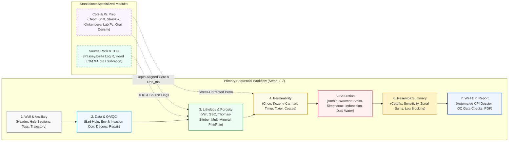
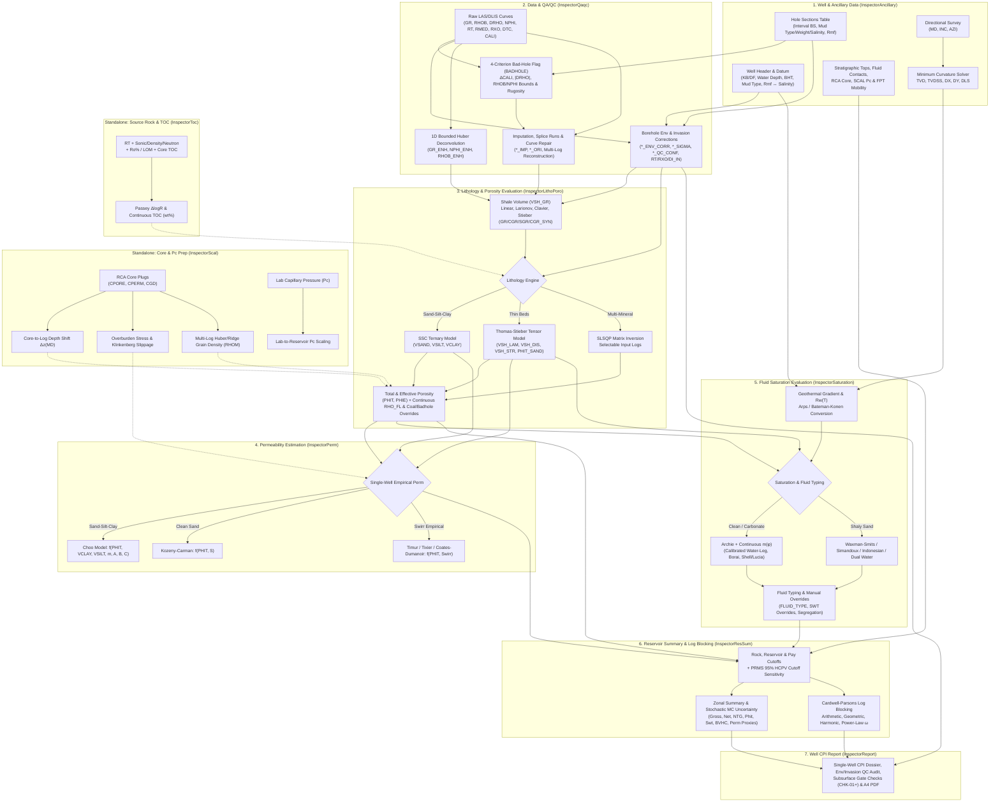

# Single-Well Petrophysical Workflow

The Single-Well space delivers deterministic, optimization-driven, and core-calibrated formation evaluation along a single wellbore trajectory. It is structured into **7 Primary Sequential Workflow Steps** culminating in a Computer Processed Interpretation (CPI) report, accompanied by **2 Standalone Specialized Modules**: **Core & Pc Prep** (`InspectorScal`) and **Source Rock & TOC** (`InspectorToc`).

When importing LAS logs, check the depth curve's **Source Unit** in the uploader. Feet are converted to meters by multiplying the depth values by 0.3048; edit the source unit if the LAS curve header is incorrect. Previously imported wells are not automatically corrected, and importing into an existing well merges data rather than replacing it.

For LAS imports through **Review / Commit**, renamed log curves retain a separate copy of their source values and unit alongside the standardized curve. Name collisions receive a `RAW_` prefix or a numeric suffix. The import summary and Well Header show each source file, mnemonic, stored curve, and raw copy; these records describe the import, not subsequent edits. Depth remains the shared, converted index rather than a separate raw curve. Optional grid regularization also applies to the raw copies. Existing imports are not backfilled.

The same log uploader also accepts DLIS and LIS79 (`.lis`) files. LIS Enhanced LIS/LIS84 variants are not supported by the current parser. Full project state—including well curves, headers, hole sections, tops, surveys, core/SCAL/FPT tables, per-zone module parameters, and trained models—can be exported and re-imported via `.qpp` Handover Packages with full database persistence.

The **Log / interval** unit selector (m or ft) affects the single-well log plot and readouts, working interval and top-bar depth filter, and shared tables whose values are in meters. Table edits, pasted values, and ancillary quick-entry depths are converted back to meters for processing. The preference is saved in the browser; it does not change stored data. Other plots, reports, and exports retain their existing units.

Zone-filtered workspace calculations require resolved zone labels for the selected well, normally from its zone data or formation tops. If zone labels are unavailable, the calculation reports an error instead of evaluating the entire well. Module parameters are persisted per interval (`well`, `zone:<name>`, or `depth:<min>-<max>`) and restored automatically when switching wells or active filters. Calculated curve groups can be selectively cleared via **Clear Calc** in the top stepper across `Top–Bottom`, `By Formation`, or the `Active Filter`.

---

## 1. Workflow Architecture (Level 1 & Level 2) {#sw-level-1-2-diagrams}

#### Level 1: Macro Workflow

#### Level 2: Sub-Process & Curve Handoff Architecture

---

## 2. Primary Sequential Steps (1 to 7)

### Step 1: Well Header, Hole Sections, Ancillary & Trajectory (`InspectorAncillary`) {#sw-step-1-ancillary}

* **Objective:** Establish well header metadata, depth-zoned borehole casing/bit-size and drilling-fluid intervals (**Hole Sections**), stratigraphic formation tops, fluid contacts, core/SCAL/pressure datasets, and the True Vertical Depth ($\text{TVD}$ / $\text{TVDSS}$) trajectory frame before log conditioning and petrophysical evaluation.

* **Well Header & Mud Filtrate Wiring:**
  Configures surface/offshore elevation datums ($\text{KB}, \text{DF}, \text{GL}$, water depth, air gap), Bottom-Hole Temperature ($\text{BHT}$) records, mud system (`WBM`, `OBM`, `SBM`), mud weight, base-oil density, and mud/filtrate/mudcake resistivities ($R_m, R_{mf}, R_{mc}$) with measurement temperatures. Editing $R_{mf}$ and temperature or mud filtrate salinity synchronizes the counterpart via Bateman-Konen and Arps temperature conversion, feeding directly into Step 2 environmental/invasion corrections and Step 3 continuous apparent fluid density ($\rho_{fl}$).

* **Hole Sections (`hole_sections`):**
  Defines depth-zoned wellbore intervals (`top`, `bottom`, `bit_size`, `mud_type`, `mud_weight`, `mud_salinity`, `rmf`, `rmf_temp`). When enabled in Step 2, Hole Sections synthesize a continuous nominal Bit Size (`BS`) curve and depth-specific mud program automatically across casing shoes, eliminating single-scalar bit-size errors across multi-section wells.

* **Formation-test mobility:** Enter or import optional drawdown mobility with formation pressure
  tests. The well plot displays positive mobility values as pink triangles at measured depth in
  Track 5, with a separate 0.01–10,000 mD/cP logarithmic scale and an FPT mobility toggle.
  Points outside that scale are counted as off-scale; depth and zone filters apply. Hover a
  point for its value, depth, and available fluid, quality, and remarks. Mobility is not
  permeability: matching numerical positions on the two scales do not imply equivalent
  properties, and no viscosity or permeability conversion is assumed.

* **Technical Foundation (Minimum Curvature Directional Survey Inversion):**
  Converts directional survey stations $(\text{MD}_i, I_i, A_i)$ (Measured Depth, Inclination, Azimuth) into continuous spatial coordinates $(\text{TVD}, \text{DX}, \text{DY})$ and dogleg severity using dogleg angle $\beta_i$ and ratio factor $RF_i$:

  $$\beta_i = \arccos\left(\cos I_{i-1} \cos I_i + \sin I_{i-1} \sin I_i \cos(A_i - A_{i-1})\right)$$

  $$RF_i = \frac{2}{\beta_i} \tan\left(\frac{\beta_i}{2}\right) \quad (\text{with } RF_i \to 1 \text{ as } \beta_i \to 0)$$

  $$\Delta \text{TVD}_i = \frac{\Delta \text{MD}_i}{2} (\cos I_{i-1} + \cos I_i) \cdot RF_i, \qquad \text{TVDSS} = \text{TVD} - \text{KB}$$

* **Input Data:** Well Header metadata, Hole Sections table, Stratigraphic Tops & Fluid Contacts, Directional survey (`MD`, `INC`, `AZI`), Routine Core (`CPORE`, `CPERM`, `CGD`), SCAL $P_c$ tables, FPT pressure/mobility points  
* **Output Data:** Synthesized `BS` & mud program, continuous `TVD`, `TVDSS`, `DX`, `DY`, Dogleg Severity (`DLS`), registered formation `ZONES`

---

### Step 2: Data & Log QA/QC (`InspectorQaqc`) {#sw-step-2-qaqc}

* **Objective:** Audit curve coverage and missingness, flag borehole washouts and pad-standoff intervals (`BADHOLE`), apply physics-based borehole environmental and radial invasion corrections with per-sample uncertainty ($\sigma$) and sensor confidence (`*_QC_CONF`), harmonize vertical resolution via 1D deconvolution, and edit, splice, or impute log curves.

* **Technical Foundation:**

    * **Four-Criterion Bad-Hole Flagging (`badhole_flagging`):**
      Combines Hole Section bit sizes (`BS`), `ruptures` KDE change-point auto-estimated bit sizes (when `BS` is absent), or nominal fallback bit size with four configurable criteria:
      1. *Differential Caliper:* $|\text{CALI} - \text{BS}| \ge \tau_{\text{cali}}$ (outputs `DCALI` and `BS`).
      2. *Density Compensation Standoff:* $|\text{DRHO}| > \tau_{\text{drho}}$ (default $0.15\,\text{g/cm}^3$).
      3. *Bulk Density / Neutron Pad-Standoff Bounds:* $\rho_b < \rho_{\min} \;\lor\; \rho_b > \rho_{\max} \;\lor\; \phi_N > \phi_{N,\max}$ (excluding coal seams when `exclude_coal=True`).
      4. *Local Rugosity & Caliper Spikes:* Flags sharp drops of $\rho_b$ below its rolling mean (`rhob_trend_factor`) or $|\text{CALI} - \operatorname{median}_w(\text{CALI})| > \tau_{\text{spike}}$.
      Emits `BADHOLE` and baseline `BADHOLE_BASE`.

    * **Unified Logging Environment, Borehole Corrections & Radial Invasion (`quick_pp.environment` & `quick_pp.borehole_corrections`):**
      Constructs a continuous onshore or offshore (`water_depth`, `air_gap`, `seabed_temp`) temperature $T(z)$ (anchored to BHT records when provided) and mud/hydrostatic pressure $P(z)$ profile, converting $R_m, R_{mf}, R_w$ to formation temperature via Arps' equation. Evaluates generic Wireline (`WL`) and Logging-While-Drilling (`LWD`) tool profiles:
      * *Gamma Ray (`GR_ENV_CORR`):* Compensates exponential mud-annulus attenuation across $d_{\text{hole}} - d_{\text{tool}}$ and strips KCl mud potassium background (~16 gAPI/%K scaled by annulus area fraction).
      * *Thermal Neutron (`NPHI_ENV_CORR`):* Additive borehole washout, temperature, pressure, mud weight, borehole/formation salinity, and tool standoff corrections.
      * *Bulk Density (`RHOB_ENV_CORR`):* Preserves vendor spine-and-ribs compensated `RHOB` when `DRHO` is present to avoid double-correcting mudcake; applies two-layer wall-gap compensation only for uncompensated density logs (with large $|\text{DRHO}|$ penalizing confidence).
      * *Resistivity Borehole & Step-Profile Radial Invasion (`RT_ENV_CORR`, `RXO_INV`, `DI_IN`, `INVASION_FLAG`, `INVASION_PROFILE`):* Removes conductive washout-annulus mixing in `WBM`, then inverts 2- or 3-curve radial resistivity suites (`RT`, `RMED`, `RXO`) via a Gaussian step-profile geometric factor $J_k(d_i) = 1 - \exp(-(d_i/r_k)^2)$ for true $R_t$, flushed $R_{xo}$, and invasion diameter $d_i$ ($6\text{–}120\,\text{in}$ grid for 3 curves; $35\,\text{in}$ fixed for 2 curves). Compares $\log_{10}(R_{xo}/R_t)$ against $\log_{10}(R_{mf}/R_w)$ to classify water-like, movable hydrocarbon-like, anomalous, or tight/uninvaded intervals.
      * *Per-Sample Uncertainty ($\sigma$) & Sensor Confidence:* Perturbation root-sum-square propagation combines sensor precision, 25% model error, assumed-parameter uncertainty, and hole-severity penalties into `<LOG>_SIGMA`, `<LOG>_QC_CONF` $\in [0, 1]$, `<LOG>_QC_STATUS` (`GOOD`, `CORRECTED`, `UNRELIABLE`), `HOLE_SEVERITY`, and bitmask `ENV_QC_REASON` (including isolated MAD `SPIKE`, stuck `FLATLINE`, and Gardner-checked sonic `CYCLE_SKIP`). Downstream modules can consume `*_ENV_CORR` with confidence-weighted blending (`QcWeightedInputsMixin`), and `*_SIGMA` propagates into stochastic Monte Carlo log uncertainty.

    * **Right-Pane Environmental, Invasion & P&T QC Views:**
      Provides dedicated right-pane diagnostic views—**Borehole Env Correction QC** ($\pm 1\sigma$ ribbons, $\Delta$-correction tracks, confidence & reason flags), **Invasion Profile** ($R_t / R_m / R_{xo}$ radial separation, $d_i$, and $R_{xo}/R_t$ vs. $R_{mf}/R_w$ classification), and **P&T Profile** (formation temperature, BHT anchors, hydrostatic vs. mud-column pressure, and depth-varying $R_m / R_{mf} / R_w$).

    * **Raw Log Resolution Enhancement & Nuclear Log Harmonization:**
      Intrinsic sensor vertical resolutions differ (`GR` ≈ 0.76 m, `NPHI` ≈ 0.55 m, `RHOB` ≈ 0.40 m FWHM for legacy strings), creating inter-sensor footprint mismatches that scatter thin-bed laminated points on the Thomas-Stieber crossplot into unphysical boomerang loops. A 1D bounded deconvolution operator harmonizes all three logs onto a common target vertical resolution $\text{FWHM}_{\text{target}}$ subject to the Shannon-Nyquist limit ($2 \cdot \Delta z$). The forward model couples true formation property $\mathbf{x}$ to log response $\mathbf{y}$ through effective Gaussian Vertical Response Function (VRF) kernels:
      
      $$\mathbf{y} = \mathbf{H}_{\text{eff}}\mathbf{x} + \mathbf{n}, \qquad \mathbf{H}_{\text{eff}} = \text{VRF}\!\left(\sqrt{\text{FWHM}_{\text{tool}}^2 - \text{FWHM}_{\text{target}}^2}\right)$$
      
      The constrained objective solves:
      
      $$\min_{\mathbf{x}} \; \tfrac{1}{2}\|\mathbf{W}(\mathbf{H}\mathbf{x} - \mathbf{y})\|_2^2 + \lambda \sum_i \phi_\delta\!\left((\mathbf{D}_1\mathbf{x})_i\right) + \tfrac{\lambda_v}{2}\|\mathbf{H}_v(\mathbf{x} - \mathbf{y})\|_2^2 \quad \text{s.t.} \quad \mathbf{l} \le \mathbf{x} \le \mathbf{u}$$
      
      with normalized Huber edge-preserving penalty $\phi_\delta$, edge-replicate boundary padding, rolling bulk-volume conservation tether $\mathbf{H}_v$, and Morozov discrepancy parameter auto-tuning based on second-difference MAD sensor noise $\hat{\sigma}_n = \operatorname{MAD}(\mathbf{D}_2\mathbf{y}) / (0.6745\sqrt{6})$, capped at `noise_cap_mult` (default 3.0×) tool noise floor to protect against dense thin-bed inflation.

    * **Missing Data Imputation & Synthetic Curve Repair:**
      **Missing Data Imputation** saves selected logs as new `_IMP` curves by default, or replaces selected curves while preserving a full-well `_ORI` backup (existing backups are never overwritten). Supports mean, median, most frequent, forward/backward fill, depth-based linear interpolation (interior gaps only), KNN, or iterative multivariate imputation (requiring $\ge 2$ curves). Active depth and zone filters apply; the right-pane **Missing Matrix** shows binned missing fractions by curve. Corrupted washout intervals can also be reconstructed via multivariate regression or Random Forest models trained on in-gauge intervals ($\text{BADHOLE} = 0$).

* **Curve editing and splicing:** In Curve Editor & Management, select **View log vs depth in
  right pane** to compare the selected curve with its original backup or edit source. In **Splice
  Runs**, optionally enter a top and/or bottom depth in metres for each run; blank limits use the
  full run and both limits include their boundary samples. The overlap mode resolves
  samples covered by both intervals; uncovered depths stay empty unless gap interpolation is
  enabled. Auto-level uses only overlap within the selected intervals. Diagnostics compare the
  first two runs. Click **Apply Splice** after changing the settings to update the preview, then
  **Save** to persist it. Log-versus-depth plots lock the horizontal scale; the mouse wheel zooms depth.

* **Input Curves:** `CALI`, `BS`, `GR`, `RHOB`, `DRHO`, `NPHI`, `RT`, `RMED`, `RXO`, `DTC`, Hole Sections & Header Environment  
* **Output Curves:** `BADHOLE`, `BADHOLE_BASE`, `BS`, `DCALI`, `*_ENV_CORR`, `*_CORR_DELTA`, `*_SIGMA`, `*_QC_CONF`, `*_QC_STATUS`, `ENV_QC_REASON`, `HOLE_SEVERITY`, `ENV_TEMP_C`, `INVASION_FLAG`, `INVASION_PROFILE`, `DI_IN`, `GR_ENH`, `NPHI_ENH`, `RHOB_ENH`, `DECONV_WEIGHT`, `*_IMP`, `*_ORI`, `*_RECON`

---

### Step 3: Lithology & Porosity Evaluation (`InspectorLithoPoro`) {#sw-step-3-litho-poro}

* **Objective:** Partition the rock matrix into mineral volumes ($V_{\text{sh}}, V_{\text{sand}}, V_{\text{silt}}, V_{\text{clay}}, V_{\text{calc}}, V_{\text{dolo}}$) and calculate Total Porosity ($\phi_t$) and Effective Porosity ($\phi_e$) corrected for shale, coal seams, bad-hole intervals, and light hydrocarbon effects.

* **Technical Foundation:**

    * **Gamma Ray Index & Empirical $V_{\text{sh}}$ Models (`vsh_gr`):**
      
      $$I_{GR} = \text{clip}\left(\frac{\text{GR} - \text{GR}_{\text{clean}}}{\text{GR}_{\text{shale}} - \text{GR}_{\text{clean}}}, 0, 1\right)$$
      
      $$\text{Linear: } V_{\text{sh}} = I_{GR}, \qquad \text{Larionov (Tertiary): } V_{\text{sh}} = 0.083 \left( 2^{3.7 \cdot I_{GR}} - 1 \right)$$
      
      $$\text{Larionov (Older / Mesozoic): } V_{\text{sh}} = 0.33 \left( 2^{2 \cdot I_{GR}} - 1 \right)$$
      
      $$\text{Clavier (1971): } V_{\text{sh}} = 1.7 - \sqrt{3.38 - (I_{GR} + 0.7)^2}, \qquad \text{Stieber (1970): } V_{\text{sh}} = \frac{I_{GR}}{3 - 2 \cdot I_{GR}}$$

    * **Sand-Silt-Clay (SSC) Ternary & Sand-Shale Models:**
      Resolves the barycentric triangle of Clean Quartz Sand $(\text{NPHI}_{\text{sd}}, \rho_{\text{sd}})$, Dry Silt $(\text{NPHI}_{\text{slt}}, \rho_{\text{slt}})$, and Dry Clay $(\text{NPHI}_{\text{cl}}, \rho_{\text{cl}})$. Saved lithology fractions (`VSAND`, `VSILT`, `VCLAY`, `VCALC`, `VDOLO`, etc.) are **matrix-relative** ($\sum V_{\text{mineral}} = 1$); the composite log plot scales them by $(1 - \phi_t)$ for bulk-volume visualization.

    * **Neutron-Density Crossplot Shale Volume ($V_{\text{sh,ND}}$):**
      Calculated from parametric projection along the matrix line in $(\phi_N, \rho_b)$ crossplot space from clean sand endpoint $\mathbf{A} = (\phi_{N,\text{sd}}, \rho_{\text{sd}})$ to dry clay endpoint $\mathbf{C} = (\phi_{N,\text{cl}}, \rho_{\text{cl}})$:
      
      $$V_{\text{sh,ND}} = \text{clip}\left(\frac{(\mathbf{x}_{\text{int}} - \mathbf{A}) \cdot (\mathbf{C} - \mathbf{A})}{\|\mathbf{C} - \mathbf{A}\|^2}, 0, 1\right)$$
      
      where $\mathbf{x}_{\text{int}}$ is the intersection of the line from fluid point $\mathbf{D} = (\phi_{N,\text{fl}}, \rho_{\text{fl}})$ through $(\phi_N, \rho_b)$ with line $\mathbf{AC}$.

    * **M-N Lithology Identification Parameters (Burke et al., 1969):**
      Combines sonic, density, and neutron measurements into porosity-independent mineralogical indices:
      
      $$M = \frac{\Delta t_{\text{fl}} - \Delta t}{\rho_b - \rho_{\text{fl}}} \times 0.01, \qquad N = \frac{\phi_{N,\text{fl}} - \phi_N}{\rho_b - \rho_{\text{fl}}}$$
      
      Standard endpoints (Quartz: $M=0.810, N=0.898$; Calcite: $M=0.827, N=0.585$; Dolomite: $M=0.778, N=0.524$; Anhydrite: $M=0.702, N=0.505$) establish diagnostic ternary triangles and feed the dynamic `M_LITH`/`N_LITH` drivers for core grain-density calibration.

    * **Thin-Bed Thomas-Stieber & Hagiwara Tensor Resistivity:**
      Partitions shale into laminated ($V_{\text{lam}}$), dispersed ($V_{\text{disp}}$), and structural ($V_{\text{struct}}$) forms (`VSH_LAM`, `VSH_DIS`, `VSH_STR`, `PHIT_SAND`, `RSAND_TS`). On the $\phi_t$ vs. $V_{\text{sh}}$ crossplot, points below the laminated line $\phi_{\text{lam}} = \phi_{\text{sd}} + (\phi_{\text{sh}} - \phi_{\text{sd}}) V_{\text{sh}}$ fall in the dispersed triangle ($V_{\text{lam}} + V_{\text{disp}}$); points above it fall in the structural triangle bounded by $\phi_{\text{str}} = \phi_{\text{sd}} + \phi_{\text{sh}} V_{\text{sh}}$ ($V_{\text{lam}} + V_{\text{struct}}$):

      $$V_{\text{lam}} = \begin{cases} \dfrac{\phi_t - \phi_{\text{sd}} + V_{\text{sh}}(1-\phi_{\text{sh}})}{1-\phi_{\text{sd}}} & \phi_t \le \phi_{\text{lam}} \\[2ex] \dfrac{\phi_{\text{sd}} + V_{\text{sh}}\,\phi_{\text{sh}} - \phi_t}{\phi_{\text{sd}}} & \phi_t > \phi_{\text{lam}} \end{cases}, \quad V_{\text{disp}} + V_{\text{struct}} = V_{\text{sh}} - V_{\text{lam}}$$

      $$R_h^{-1} = \frac{1 - V_{\text{lam}}}{R_{\text{sand}}} + \frac{V_{\text{lam}}}{R_{h,\text{shale}}}, \qquad R_v = (1 - V_{\text{lam}}) R_{\text{sand}} + V_{\text{lam}} R_{v,\text{shale}}$$

    * **Multi-Mineral Constrained Optimization (SLSQP):**
      Given selectable log measurements $\mathbf{b}$ (`input_logs`, minimum 2 curves among `GR`, `NPHI`, `RHOB`, `PEF`, `DTC`, `POTA`, `THOR`, `URAN`) and mineral response matrix $\mathbf{A}$:
      
      $$\min_{\mathbf{v}} \sum_{j=1}^N w_j \left( \frac{\sum_{i=1}^M A_{ji} v_i - b_j}{\sigma_j} \right)^2 \quad \text{s.t.} \quad \sum_{i=1}^{M+1} v_i = 1, \quad 0 \le v_i \le 1$$

    * **Total Porosity ($\phi_t$) & Effective Porosity ($\phi_e$):**
      
      $$\text{Density Porosity: } \phi_{D} = \frac{\rho_{\text{ma}} - \rho_b}{\rho_{\text{ma}} - \rho_{\text{fl}}}, \qquad \text{Sonic (Wyllie): } \phi_S = \frac{\Delta t - \Delta t_{\text{ma}}}{\Delta t_{\text{fl}} - \Delta t_{\text{ma}}}$$
      
      $$\text{Hunt-Raymer: } \phi_S = -c - \sqrt{c^2 + \frac{\Delta t_{\text{ma}}}{\Delta t} - 1}, \quad c = \frac{\Delta t_{\text{ma}}}{2\Delta t_{\text{fl}}} - 1$$
      
      $$\phi_e = \max\left(0, \;\phi_t - V_{\text{clay}} \cdot \phi_{\text{clay}}\right) \quad \text{or} \quad \phi_e = \phi_t (1 - V_{\text{sh}})$$

* **Continuous fluid density ($\rho_{fl}$):** Offers `Static` scalar $\rho_{fl}$, `Mud & Zonal Profile` (Batzle & Wang brine for WBM or P-T corrected base oil for OBM/SBM, wired to Well Header & Hole Section `mud_type`, `rmf`, and `mud_salinity`), and `Auto Iterative (Rxo / Sw^0.2)` (3-tier coupled $\rho_{fl}$–$\phi_D$ solver degrading gracefully from $S_{xo}$ to Poupon $S_w^c$ to zonal $S_{hr}$). Emits QC curves `RHO_FL`, `RHO_MF`, `SXO_EST`, `PHID_RAW_100`, and `RHO_FL_TIER` displayed on the **Porosity Methods vs Depth + Core** plot.

* **Coal Seam Flagging, Badhole Mitigation & Reversible Manual Overrides:**
  Detects low-density, high-neutron coal beds (`COAL_FLAG`) using threshold bounds (`RHOB`, `NPHI`), rolling-trend deviation, seam gap bridging, and adaptive gradient shoulder recovery so adjacent reservoir sand boundaries are not over-flagged. Supports `badhole_treatment` (`none`, `vsh_gr`, `interpolate`, `ignore`) and well-scoped, interval-based **Manual Overrides** to force or clear `COAL_FLAG` and `BADHOLE` non-destructively while preserving `COAL_BASE` and `BADHOLE_BASE` so overrides can be edited or reverted at any time.

* **Vsh from gamma, Porosity Comparison & Spectral Crossplots:**
  Select `GR`, `SGR`, `CGR`, or synthetic `CGR_SYN = a_Th × THOR + a_K × POTA` in **Vshale Calibration**. Use **Porosity Methods vs Depth + Core** to compare density, neutron-density crossplot, Wyllie/Hunt-Raymer sonic, and weighted/arithmetic/RMS (`avg_gaymard`) porosity methods against core porosity (`CPORE`, matched within 0.5 m, excluding flagged coal and badhole samples). Spectral right-pane crossplots (`THOR` vs `POTA`, `PEF` vs `POTA`, `PEF` vs `Th/K`) provide clay mineralogical diagnostics.

* **Input Curves:** `GR`, `CGR`, `SGR`, `RHOB`, `NPHI`, `PEF`, `DTC`, `POTA`, `THOR`, `URAN`, optional `*_ENV_CORR` / `*_ENH`  
* **Output Curves:** `VSHALE`, `VSAND`, `VSILT`, `VCLAY`, `VCALC`, `VDOLO`, `PHIT`, `PHIE`, `RHOM`, `COAL_FLAG`, optional `VSH_LAM`, `VSH_DIS`, `VSH_STR`, `PHIT_SAND`, `RSAND_TS`, `RHO_FL`, `RHO_MF`

---

### Step 4: Permeability Estimation (`InspectorPerm`) {#sw-step-4-perm}

* **Objective:** Generate continuous single-well absolute permeability (`PERM`, in mD) profiles from evaluated porosity, clay/silt fractions, or irreducible water saturation ($S_{\text{wirr}}$), calibrated against routine core permeability (`CPERM`).

> [!NOTE]
> **Scope Boundary — Single-Well Empirical Perm vs. Multi-Well Rock-Type Perm:** Single-Well Step 4 evaluates continuous log-based empirical correlations (`Choo`, `Kozeny-Carman`, `Timur`, `Tixier`, `Coates`). Discrete Hydraulic Flow Units (**Amaefule FZI / RQI**, **Winland $r_{35}$**, **Lucia RFN**) and rock-type-partitioned power-law regressions ($k = a_k \cdot \phi^{b_k}$ → `PERM_TRANS`) belong to the **Multi-Well Workflow** ([Step 3: Rock Typing](multi_well.md#mw-step-3-rock-typing) and [Step 4: Field Permeability Transforms](multi_well.md#mw-step-4-perm-transform)), where multi-well core datasets establish statistically representative flow units across the field.

* **Technical Foundation (`quick_pp.permeability`):**

    * **Choo (2010) Sand-Silt-Clay Shaly Clastic Model (`choo_permeability`):**
      Relates total porosity ($\phi_t$) and grain-size tortuosity penalties from clay ($V_{\text{clay}}$) and silt ($V_{\text{silt}}$) fractions:
      
      $$k_{\text{Choo}} = \frac{A \cdot \phi_t^B}{10^{\left(6 V_{\text{clay}} + 3 V_{\text{silt}}\right)}}$$
      
      where $A$ is the grain-size constant ($A \approx 0.125 \cdot r_{\text{grain}}^2 / 10$, library default $1.65 \times 10^7$, UI default $10^6$), and $B$ is the porosity compaction/cementation exponent. When $B$ is not explicitly specified, it is derived from cementation exponent $m$ (default $2.0$) and constant $C$ (default $1.78$) via:
      
      $$B = m \left( \frac{2}{C} + 1 \right) + 2$$

    * **Kozeny-Carman Clean / Unconsolidated Sand Model (`kozeny_carman_permeability`):**
      
      $$k_{\text{KC}} = \frac{\phi_t^3}{5 S^2 (1 - \phi_t)^2}$$
      
      where $S$ is the specific grain surface area factor (default $0.01$).

    * **Timur (1968) Empirical Sandstone Model (`timur_permeability`):**
      
      $$k_{\text{Timur}} = \frac{0.136 \cdot \phi_t^{4.4}}{S_{\text{wirr}}^2}$$
      
      with $\phi_t$ and $S_{\text{wirr}}$ expressed as decimal fractions ($\text{v/v}$).

    * **Tixier (1949) Irreducible Saturation Model (`tixier_permeability`):**
      
      $$k_{\text{Tixier}} = \frac{62.5 \cdot \phi_t^6}{S_{\text{wirr}}^2}$$

    * **Coates (1974) / Coates-Dumanoir Free-Fluid Model (`coates_permeability`):**
      
      $$k_{\text{Coates}} = \left( \frac{\phi^2}{a} \cdot \frac{1 - S_{\text{wirr}}}{S_{\text{wirr}}} \right)^2 \quad (a = 1 \text{ default})$$

    * **Python Library API Additional Correlations:**
      `quick_pp.permeability` also provides `morris_biggs_permeability` ($k = (C \cdot \phi_t^3 / S_{\text{wirr}})^2$, $C=250$ medium oil, $C=79$ gas), `morris_biggs_modified_permeability`, and Park Jones / Pirson relative-permeability & water-cut screening utilities (`estimate_krw`, `estimate_kro`, `estimate_wor`, `estimate_wc`) for scripting workflows.

    * **Thomas-Stieber Thin-Bed Permeability Option (`use_thomas_stieber=True`):**
      When Thomas-Stieber curves (`PHIT_SAND`, `VSH_LAM`, `VSH_DIS`) are present, evaluates clean sand-lamina permeability $k_{\text{sand}}(\phi_{t,\text{sand}}, V_{\text{sh,dis}})$ and scales horizontal thin-bed permeability by net sand fraction:
      
      $$k_h = (1 - V_{\text{sh,lam}}) \cdot k_{\text{sand}}$$
      
      Flagged coal beds (`COAL_FLAG` or `VCOAL >= 0.5`) and non-porous intervals ($\phi_t \le 0$) are clamped to $0.001\,\text{mD}$.

* **Input Curves:** `PHIT`, `VCLAY`, `VSILT` (or `VSHALE` fallback), `SWIRR` parameter, optional `PHIT_SAND`, `VSH_LAM`, `VSH_DIS`, Core `CPERM`  
* **Output Curves:** `PERM` (mD), Core calibration metrics ($\log_{10}\text{RMSE}$, $\log_{10}\text{MAE}$, Factor Error $10^{\text{RMSE}}$, $R^2$)

* **Permeability comparison:** Run Permeability, then select **Permeability Methods
  vs Depth + Core** from the Crossplot dropdown to overlay Choo, Kozeny-Carman, Timur,
  Tixier, and Coates-Dumanoir curves against `CPERM` on a logarithmic
  permeability axis (fixed at 0.1–100,000 mD). The first track shows `VSHALE`
  (clay plus silt for the SSC model), matching the saturation comparison plot.
  Use the mouse wheel to zoom depth. Toggle methods and use the emphasized active
  method as a reference. The comparison uses the current model parameters, porosity and
  lithology inputs, including Thomas-Stieber inputs when enabled, without
  changing working or saved `PERM`. Only positive values are displayed or
  included in the matched-core metrics. RMSE and bias are in $\log_{10}$ permeability
  units; bias is $\log_{10}(\text{PERM}) - \log_{10}(\text{CPERM})$. Coal and badhole samples are
  excluded from metrics. Core is matched to the nearest log sample within
  0.5 m, with markers at matched log depths. Depth and zone filters apply;
  brushed calculation selections are not supported.

---

### Step 5: Fluid Saturation Evaluation (`InspectorSaturation`) {#sw-step-5-saturation}

* **Objective:** Quantify Total Water Saturation ($S_{wt}$) and Effective Water Saturation ($S_{we}$) across clean sands, carbonates, laminated thin beds, and conductive shaly formations, paired with multi-criteria reservoir fluid typing.

* **Technical Foundation:**

    * **Geothermal Gradient, Bateman-Konen Salinity & Arps Brine Resistivity ($R_w(T)$):**
      
      $$T(z) = T_{\text{surf}} + g_T \cdot \text{TVD}(z), \qquad R_w(T) = R_w(T_{\text{ref}}) \cdot \frac{T_{\text{ref}} + 21.5}{T(z) + 21.5} \quad (^\circ\text{C})$$

    * **Archie Equation (Clean Sands & Carbonates):**
      
      $$S_{wt} = \left( \frac{a \cdot R_w}{\phi_t^m \cdot R_t} \right)^{\frac{1}{n}}$$

    * **Waxman-Smits Shaly Sand Model:**
      Solves for excess electrical conduction via Cation Exchange Capacity ($Q_v$, in $\text{meq/mL}$, derived from clay CEC & $\rho_{\text{dry,clay}}$, Juhasz normalized $Q_{vn}$, or crossplot calibration) and counter-ion mobility ($B$, in $\text{mho}\cdot\text{m}^2/\text{meq}$):
      
      $$Q_v = \frac{\text{CEC} \cdot (1 - \phi_t) \cdot \rho_{\text{ma,clay}} \cdot V_{\text{clay}}}{\phi_t}, \qquad \frac{1}{R_t} = \frac{\phi_t^{m^*} S_{wt}^{n^*}}{a^*} \left( \frac{1}{R_w} + \frac{B \cdot Q_v}{S_{wt}} \right)$$
      
      Solved via Newton-Raphson iteration for $S_{wt}$, followed by clay-bound water stripping:
      
      $$S_{we} = \text{clip}\left(\frac{S_{wt} \cdot \phi_t - V_{\text{clay}} \phi_{\text{clay}}}{\phi_e}, 0, 1\right)$$

    * **Simandoux, Indonesian & Dual Water Shaly Sand Models:**
      
      $$\text{Simandoux: } \frac{1}{R_t} = \frac{V_{\text{sh}}}{R_{\text{sh}}} S_w + \frac{\phi_e^m}{a \cdot R_w} S_w^n$$
      
      $$\text{Indonesian: } \frac{1}{\sqrt{R_t}} = \left( \sqrt{\frac{V_{\text{sh}}^{2 - V_{\text{sh}}}}{R_{\text{sh}}}} + \sqrt{\frac{\phi_e^m}{a \cdot R_w}} \right) \cdot S_w^{n/2}$$
      
      $$\text{Dual Water: } C_t = \phi_t^m S_{wt}^n \left( C_{wf} + \frac{S_{wb}}{S_{wt}} (C_{wb} - C_{wf}) \right)$$
      
      Supports Thomas-Stieber thin-bed evaluation (`use_thomas_stieber=True`) using sand-lamina porosity `PHIT_SAND`, dispersed shale `VSH_DIS`, and Hagiwara horizontal/vertical tensor-inverted sand resistivity `RSAND_TS`.

    * **Cementation Exponent Calibration in 100% Water Leg ($m$) & Continuous $m(\phi)$:**
      Inverts Archie or Indonesian assuming $S_w = 1.0$ across depth- or zone-filtered water legs:
      
      $$\text{Archie: } m = \frac{\ln(R_w / R_t)}{\ln(\phi_t)}, \qquad \text{Indonesian: } m = \frac{2}{\ln(\phi_t)} \ln\left(\sqrt{R_w}\left(\frac{1}{\sqrt{R_t}} - \frac{V_{\text{sh}}^{1 - 0.5 V_{\text{sh}}}}{\sqrt{R_{\text{sh}}}}\right)\right)$$
      
      Supports continuous $m(z)$ via calibrated linear trend ($m = a\phi_t + b$), **Borai (1987)** tight-rock model ($m = 2.2 - \frac{0.035}{\phi_t + 0.042}$), or **Shell / Lucia (1983)** carbonate model ($m = 1.87 + \frac{0.019}{\phi_t}$).

    * **Reservoir Fluid Typing, Segregation & Manual Overrides (`classify_fluid_types`, `fix_fluid_segregation`):**
      Differentiates `GAS`, `OIL`, `UNCONFIRMED`, and `WATER` intervals via Neutron-Density crossover ($\Delta\phi = \phi_D - \phi_N$), apparent hydrocarbon density ($\rho_{hc}$), dipole sonic $V_p/V_s$, Haworth $C_1\text{–}C_5$ mud-gas ratios, or `oil_only`/`gas_only` constraints. Enforces gravity segregation (`fix_fluid_segregation`) within continuous compartments and supports well-scoped, compact scrollable interval **Manual Overrides** for both `SWT` and `FLUID_TYPE`.

* **Input Curves:** `RT`, `PHIT`, `PHIE`, `VSHALE`, `VCLAY`, `TVDSS`/`TVD`, `NPHI`, `RHOB`, optional `RSAND_TS`, `DTC`, `DTS`, `C1`–`NC5`  
* **Output Curves:** `SWT`, `SWE`, `BVW`, `BVW_IRR`, `M_CALC`, `FLUID_TYPE`, `HC_FLAG`, `GAS_FLAG`, `OIL_FLAG`, `UNC_FLAG`, `RHO_HC`, `VOIL`, `VGAS`, `VUNC`, `BVHC`

---

### Step 6: Reservoir Summary & Log Blocking (`InspectorResSum`) {#sw-step-6-ressum}

* **Objective:** Apply petrophysical cutoffs (including optional permeability cutoffs) and empirical cutoff sensitivity analysis to delineate Net Rock, Net Reservoir, and Net Pay, compute PRMS/SEC-compliant zonal averages, quantify stochastic log uncertainty, and upscale fine logs onto cellular simulation grids.

* **Technical Foundation (`quick_pp.ressum` & `quick_pp.upscaling`):**

    * **Rock, Reservoir & Pay Interval Flagging (`flag_interval`):**
      Evaluates shale volume (`VCLAY` or `VSHALE`), total porosity (`PHIT`), water saturation (`SWT`), and permeability (`PERM_TRANS` when present, otherwise `PERM`):
      
      $$F_{\text{rock}} = \mathbb{I}\left(V_{\text{sh}} \le V_{\text{sh,cut}}\right), \qquad F_{\text{res}} = F_{\text{rock}} \;\land\; \mathbb{I}\left(\phi_t \ge \phi_{\text{cut}}\right) \;\land\; \mathbb{I}\left(k \ge k_{\text{cut}} \text{ if enabled}\right)$$
      
      $$F_{\text{pay}} = F_{\text{res}} \;\land\; \mathbb{I}\left(S_{wt} \le S_{w,\text{cut}}\right)$$

    * **Empirical Cutoff Sensitivity Analysis (`cutoffs_analysis`):**
      Sweeps candidate $V_{\text{sh}}$, $\phi_t$, and $S_{wt}$ cutoffs against cumulative Hydrocarbon Pore Volume ($\text{HCPV}$) and Net Pay thickness to identify inflection knees at a target PRMS HCPV recovery percentile (default 95%).

    * **PRMS/SEC-Compliant Zonal Integration (`calc_reservoir_summary`):**
      
      $$H_{\text{gross}} = \sum_{i \in \text{Zone}} h_i, \qquad H_{\text{net}} = \sum_{i \in \text{Pay}} h_i, \qquad \text{NTG} = \frac{H_{\text{net}}}{H_{\text{gross}}}$$
      
      $$\overline{\phi_t} = \frac{\sum_{i \in \text{Pay}} \phi_{t,i} h_i}{H_{\text{net}}}, \qquad \overline{S_{wt}} = \frac{\sum_{i \in \text{Pay}} S_{wt,i} \phi_{t,i} h_i}{\sum_{i \in \text{Pay}} \phi_{t,i} h_i}, \qquad \overline{\text{BVHC}} = \frac{\sum_{i \in \text{Pay}} \phi_{t,i} (1 - S_{wt,i}) h_i}{H_{\text{net}}}$$

    * **Cardwell-Parsons Directional Log Blocking & Upscaling (`upscale_logs`):**
      Upscales fine-scale logs onto fixed cell thicknesses or geological zones using thickness-weighted arithmetic averaging ($\phi, V_{\text{sh}}, \text{NTG}$), pore-volume-weighted saturation averaging ($\overline{S_w}$, strictly conserving $\text{BVHC}$), majority-vote discrete rock-type upscaling, and Cardwell-Parsons (1945) permeability laws:
      
      $$\bar{k}_{\text{arith}} = \frac{\sum h_i k_i}{\sum h_i} \;(\omega=1), \qquad \bar{k}_{\text{geom}} = \exp\!\left(\frac{\sum h_i \ln k_i}{\sum h_i}\right) \;(\omega \to 0), \qquad \bar{k}_{\text{harm}} = \frac{\sum h_i}{\sum h_i / k_i} \;(\omega=-1)$$
      
      $$\bar{k}_{\omega} = \left( \frac{\sum h_i k_i^{\omega}}{\sum h_i} \right)^{1/\omega} \quad (\omega \in [-1, 1]), \qquad \frac{k_v}{k_h} = \frac{\bar{k}_{\text{harm}}}{\bar{k}_{\text{arith}}}$$

    * **Stochastic Single-Well Monte Carlo Uncertainty (`calc_stochastic_reservoir_summary`):**
      Propagates input log uncertainties (including per-sample `*_SIGMA` from Step 2 environmental corrections when present) across $N$ realizations to produce P10/P50/P90 curves (`PHIT_P10..P90`, `SW_P10..P90`, `BVHC_P10..P90`) and probabilistic zonal summaries.

* **Input Data:** `VCLAY`/`VSHALE`, `PHIT`, `SWT`, `PERM_TRANS`/`PERM`, `FLUID_TYPE`, Stratigraphic `ZONES`  
* **Output Data:** `RES_FLAG`, `PAY_FLAG`, Zonal rollup table, Cutoff sensitivity curves, Blocked cellular & step-profile logs, Stochastic P10/P50/P90 CPI bands

---

### Step 7: Well CPI Report & Dossier Generation (`InspectorReport`) {#sw-step-7-report}

* **Objective:** Assemble all continuous single-well evaluations, borehole environmental & radial invasion QC audits, crossplots, core calibration metrics, cutoffs, zonal summaries, and subsurface gate checks into a publishable Single-Well CPI Dossier (`SINGLE_WELL_CPI`) in Markdown, interactive preview, and print-ready A4 PDF.

* **Key Capabilities:**
  * **Borehole QC & Invasion Audit Integration:** Automatically tabulates mud-program Hole Sections, bad-hole percentages, per-sensor environmental correction deltas, `*_SIGMA` uncertainty, `*_QC_CONF` sensor reliability, documented assumptions, and radial invasion ($R_{xo}/R_t$ vs. $R_{mf}/R_w$) movable-hydrocarbon statistics alongside high-DPI QC plots.
  * **Pre-Render Subsurface Gate-Check Audit (`CHK-01`+):** Executes automated QA/QC verification gates across borehole conditioning, depth alignment, core parity, saturation physics, and uncertainty propagation, flagging anomalies with severity ratings and required handover remediation actions.
  * **Customizable Sections & Export:** Supports per-section petrophysicist notes, optional AI narrative synthesis, high-DPI composite CPI plots, and paginated A4 PDF compilation.

---

## 3. Standalone Lab Module: Core & Pc Prep (`InspectorScal`) {#sw-standalone-core-pc}

> [!NOTE]
> **Architecture Note:** Dynamic multiphase **Relative Permeability modeling and ECLIPSE `SWOF` deck generation are consolidated into the Multi-Well Space** ([MultiWellSwirr](multi_well.md#mw-standalone-scal-relperm)), where rock-type partitioned $S_{\text{wirr}}$ fits and Corey/LET functions are calibrated consistently across the field. The Single-Well `InspectorScal` module serves as the **dedicated laboratory conditioning workbench** for core depth alignment, stress/Klinkenberg corrections, lab capillary pressure scaling, and core grain-density ($\rho_{ma}$) calibration.

* **Objective:** Condition Routine Core Analysis ($\text{RCA}$) ground-truth samples, apply overburden stress and gas slippage corrections, scale laboratory MICP / porous plate / centrifuge capillary pressure measurements to in-situ reservoir conditions, and calibrate multi-log matrix density trends.

* **Technical Foundation:**

    * **Interactive Core-to-Log Dynamic Depth Shifting:**
      Aligns core plugs ($\phi_{\text{core}}, k_{\text{core}}$) to wireline logs ($\rho_b, \text{GR}$) via piece-wise depth warping shifts $\Delta z(\text{MD})$:
      
      $$\text{MD}_{\text{shifted}} = \text{MD}_{\text{core}} + \Delta z(\text{MD})$$

    * **Overburden Confining Stress Corrections:**
      Converts ambient laboratory porosity ($\phi_{\text{amb}}$) and permeability ($k_{\text{amb}}$) to effective reservoir confining stress $\sigma_{\text{net}}$:
      
      $$\phi_{\text{res}} = \phi_{\text{amb}} \cdot (1 - C_\phi \cdot \sigma_{\text{net}}), \qquad k_{\text{res}} = k_{\text{amb}} \cdot \exp(-C_k \cdot \sigma_{\text{net}})$$
      
      **Log-derived option:** Integrates bulk density over positive-down TVD to calculate vertical stress (`SV_EST`), estimates pore pressure (`PP_EST`) from a user-selected gradient, computes dynamic Poisson's ratio (`NU_DYN`) from `DTC`/`DTS` when available, and derives mean effective confining stress (`NCS_EST`).

    * **Klinkenberg Gas Slippage Correction:**
      Corrects air permeability ($k_{\text{air}}$) to equivalent liquid permeability ($k_{\infty}$) using either the Jones or Heithaus formulation:
      
      $$k_{\infty} = \frac{k_{\text{air}}}{1 + \frac{b_K}{P_{\text{mean}}}}$$

    * **Lab-to-Reservoir Capillary Pressure ($P_c$) Scaling:**
      Rescales laboratory air-mercury, air-brine, or oil-water capillary pressures ($P_{c,\text{lab}}$) to reservoir fluid conditions ($P_{c,\text{res}}$) using explicit lab fluid-system interfacial tension and contact angle without hardcoded pressure-threshold assumptions:
      
      $$P_{c,\text{res}} = P_{c,\text{lab}} \cdot \frac{(\sigma \cos\theta)_{\text{res}}}{(\sigma \cos\theta)_{\text{lab}}}$$

    * **Core-Calibrated Grain / Matrix Density ($\rho_{ma}$) Correlation:**
      Calibrates a project-wide matrix density trend from core grain density (`CGD`) that overrides the mineral-model $\rho_{ma}$ in Step 3 density porosity and persists `RHOM`. Supports a single anchored gamma driver:
      
      $$\rho_{ma}(z) = \rho_{ma,\text{clean}} + k \cdot \left(\text{driver}(z) - \text{driver}_{\text{clean}}\right)$$
      
      or the default **multi-log ridge / Huber IRLS regression** across `GR`/`CGR`/`SGR`, `RHOB`, `NPHI`, Burke's `M_LITH`/`N_LITH`, and acoustic impedance `AI`:
      
      $$\rho_{ma}(z) = b_0 + \sum_j \beta_j \frac{\text{log}_j(z) - c_j}{s_j}$$
      
      reporting $R^2$, RMSE, per-driver VIF collinearity, Breusch-Pagan heteroscedasticity, IQR swing weightage, and native-unit slopes.

* **Input Data:** Core plugs table (`DEPTH`, `CPORE`, `CPERM`, `CGRAIN_DENSITY`), Overburden stress parameters, Lab/Reservoir IFT and contact angles, driver logs (`GR`, `CGR`, `SGR`, `RHOB`, `NPHI`, `M_LITH`, `N_LITH`, `AI`)  
* **Output Data:** `CPOR_SHIFTED`, `CPERM_SHIFTED`, `SV_EST`, `PP_EST`, `NU_DYN`, `NCS_EST`, Stress/Klinkenberg-corrected core properties, Scaled $P_c$ curves, Project-scoped grain-density correlation (`RHOM`)

---

## 4. Standalone Module: Source Rock & Total Organic Carbon (TOC) (`InspectorToc`) {#sw-standalone-source-rock}

* **Objective:** Identify organic-rich source rock intervals, model thermal maturity, and quantify continuous Total Organic Carbon ($\text{TOC}$, in wt%) profiles from wireline resistivity and porosity logs calibrated against core pyrolysis geochemical data.

* **Technical Foundation:**

    * **Passey et al. (1990) $\Delta\log R$ Technique:**
      Overlays a scaled porosity log ($\Delta t$, $\rho_b$, or $\phi_N$) on deep resistivity ($R_t$) such that one logarithmic resistivity decade corresponds to $50\,\mu\text{s/ft}$ sonic transit time ($0.02$), $-0.25\,\text{g/cm}^3$ ($-2.5$ scaling) bulk density, or $0.25\,\text{v/v}$ ($+4.0$ scaling) neutron porosity:
      
      $$\Delta\log R = \log_{10}(R_t / R_{\text{baseline}}) + \text{coeff} \cdot (\phi_{\text{log}} - \phi_{\text{baseline}})$$
      
      where $R_{\text{baseline}}$ and $\phi_{\text{baseline}}$ represent lean, water-saturated non-source shale (selectable manually or via auto-detection).

    * **Hood et al. (1975) Level of Organic Metamorphism (LOM) & Continuous TOC:**
      
      $$\text{LOM} = 10.59 + 4.54 \cdot \ln(R_o), \qquad \text{TOC} = \Delta\log R \cdot 10^{\left(2.297 - 0.1688 \cdot \text{LOM}\right)} + \text{TOC}_{\text{baseline}}$$
      
      Negative $\Delta\log R$ separations in non-source rocks are clamped to $\text{TOC}_{\text{baseline}}$ (default 0.8 wt%) when `clamp_negative=True`.

    * **Core Geochemical Calibration (`calibrate_toc_to_core`):**
      Regresses measured core TOC (`CTOC`) against log-derived $\Delta\log R$ ($\text{TOC}_{\text{core}} = a \cdot \Delta\log R + b$), deriving implied maturity $\text{LOM}_{\text{implied}} = (2.297 - \log_{10} a) / 0.1688$.

    * **Composite Log & Crossplot Diagnostics:**
      Track 2 overlays $R_t$ and porosity-equivalent resistivity $R_{\text{poro}}$ ($0.2\text{–}2000\,\Omega\cdot\text{m}$); Track 4 displays `TOC` (0–10 wt%) with source-rock shading (`TOC >= 2.0 wt%`), paired with right-pane $\Delta\log R$ vs. core calibration crossplots.

* **Input Data:** `RT`, Porosity Log (`DT`, `RHOB`, or `NPHI`), $R_{\text{baseline}}$, $\phi_{\text{baseline}}$, $R_o$ (%) or LOM, $\text{TOC}_{\text{baseline}}$, optional Core TOC (`CTOC`)  
* **Output Data:** `DELTA_LOG_R`, `TOC`, `TOC_PASSEY`, `TOC_SHALE_FLAG`
