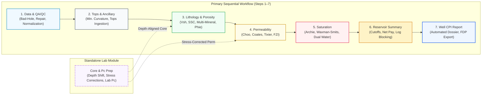
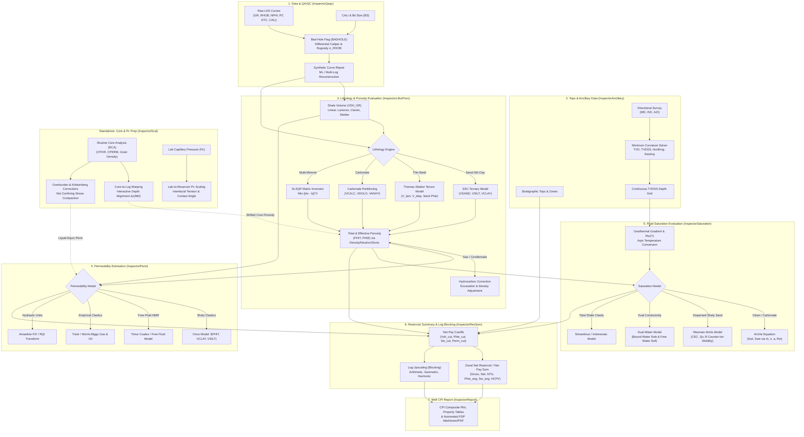

# Single-Well Petrophysical Workflow

The Single-Well space delivers deterministic, optimization-driven, and core-calibrated formation evaluation along a single wellbore trajectory. It is structured into **7 Primary Sequential Workflow Steps** culminating in a Computer Processed Interpretation (CPI) report, accompanied by a **Standalone Core & Pc Prep Lab Module**.

---

## 1. Workflow Architecture (Level 1 & Level 2) {#sw-level-1-2-diagrams}

### Level 1: Macro Workflow

### Level 2: Sub-Process & Curve Handoff Architecture

---

## 2. Primary Sequential Steps (1 to 7)

### Step 1: Data & Log QA/QC (`InspectorQaqc`) {#sw-step-1-qaqc}

* **Objective:** Identify intervals where borehole washout or severe rugosity invalidates shallow-reading pad tools ($\text{RHOB}, \text{NPHI}, \text{PEF}$), perform environmental corrections, and reconstruct missing or corrupted log intervals using multi-log regressions.

* **Technical Foundation:**

    * **Differential Caliper & Rugosity Flagging:**
      Differential caliper $\Delta \text{CALI} = \text{CALI} - \text{BS}$ measures borehole enlargement relative to bit size. A rolling window of standard deviation $\sigma_{\text{RHOB}}$ evaluates micro-rugosity. The boolean `BADHOLE` flag is triggered if:
      
      $$\Delta \text{CALI} > \tau_{\text{cali}} \quad \lor \quad \sigma_{\text{RHOB}} > \tau_{\sigma} \quad \lor \quad \rho_b < 1.95\,\text{g/cm}^3 \quad \lor \quad \rho_b > 3.05\,\text{g/cm}^3$$

    * **Borehole Environmental Corrections:**
      Mudcake buildup and borehole temperature/pressure effects are compensated analytically:
      
      $$\Delta \rho_{\text{mudcake}} = -0.015 \cdot (\text{CALI} - \text{BS}) \cdot \frac{\rho_m - 1.0}{\rho_m}$$

    * **Synthetic Curve Repair:**
      Corrupted pad readings are reconstructed via multivariate regression or Random Forest models trained on in-gauge intervals ($\text{BADHOLE} = 0$) using deep-reading, borehole-insensitive logs ($\text{GR}, \text{DTC}, \ln(\text{RT})$).

* **Input Curves:** `CALI`, `BS`, `GR`, `RHOB`, `NPHI`, `DTC`, `RT`  
* **Output Curves:** `BADHOLE` (flag), `RHOB_CORR`, `NPHI_CORR`, `GR_CORR`

---

### Step 2: Tops & Ancillary Data (`InspectorAncillary`) {#sw-step-2-ancillary}

* **Objective:** Establish the True Vertical Depth Sub-Sea ($\text{TVDSS}$) coordinate frame, ingest stratigraphic formation tops, and manage wellbore survey geometry.

* **Technical Foundation:**

    * **Minimum Curvature Directional Survey Inversion:**
      Converts directional survey stations $(\text{MD}_i, I_i, A_i)$ (Measured Depth, Inclination, Azimuth) into continuous spatial coordinates $(\text{TVD}, N, E)$ using the dogleg angle $\beta_i$ and ratio factor $RF_i$:
      
      $$\beta_i = \arccos\left(\cos I_{i-1} \cos I_i + \sin I_{i-1} \sin I_i \cos(A_i - A_{i-1})\right)$$
      
      $$RF_i = \frac{2}{\beta_i} \tan\left(\frac{\beta_i}{2}\right) \quad (\text{with } RF_i \to 1 \text{ as } \beta_i \to 0)$$
      
      $$\Delta \text{TVD}_i = \frac{\Delta \text{MD}_i}{2} (\cos I_{i-1} + \cos I_i) \cdot RF_i$$
      
      $$\text{TVDSS} = \text{TVD} - \text{KB}$$

* **Input Data:** Directional survey CSV, Kelly Bushing elevation ($\text{KB}$), Stratigraphic Tops  
* **Output Data:** Continuous `TVD`, `TVDSS`, `DX`, `DY`, Formation tops depth registration

---

### Step 3: Lithology & Porosity Evaluation (`InspectorLithoPoro`) {#sw-step-3-litho-poro}

* **Objective:** Partition the rock solid volume into mineral volumes ($V_{\text{sh}}, V_{\text{sand}}, V_{\text{silt}}, V_{\text{clay}}, V_{\text{calc}}, V_{\text{dolo}}$) and calculate Total Porosity ($\phi_t$) and Effective Porosity ($\phi_e$) corrected for shale and light hydrocarbon effects.

* **Technical Foundation:**

    * **Gamma Ray Index & Empirical $V_{\text{sh}}$ Models:**
      
      $$I_{GR} = \text{clip}\left(\frac{\text{GR} - \text{GR}_{\text{clean}}}{\text{GR}_{\text{shale}} - \text{GR}_{\text{clean}}}, 0, 1\right)$$
      
      $$\text{Linear: } V_{\text{sh}} = I_{GR}$$
      
      $$\text{Larionov (Tertiary): } V_{\text{sh}} = 0.083 \left( 2^{3.7 \cdot I_{GR}} - 1 \right)$$
      
      $$\text{Larionov (Older / Mesozoic): } V_{\text{sh}} = 0.33 \left( 2^{2 \cdot I_{GR}} - 1 \right)$$
      
      $$\text{Clavier (1971): } V_{\text{sh}} = 1.7 - \sqrt{3.38 - (I_{GR} + 0.7)^2}$$
      
      $$\text{Stieber (1970): } V_{\text{sh}} = \frac{I_{GR}}{3 - 2 \cdot I_{GR}}$$

    * **Sand-Silt-Clay (SSC) Ternary Model:**
      Partitioning resolves the barycentric triangle of Clean Quartz Sand $(\text{NPHI}_{\text{sd}}, \rho_{\text{sd}})$, Dry Silt $(\text{NPHI}_{\text{slt}}, \rho_{\text{slt}})$, and Dry Clay $(\text{NPHI}_{\text{cl}}, \rho_{\text{cl}})$:
      
      $$V_{\text{sand}} + V_{\text{silt}} + V_{\text{clay}} + \phi_t = 1$$

    * **Thin-Bed Thomas-Stieber & Tensor Resistivity:**
      Partitions shale into laminated ($V_{\text{lam}}$), dispersed ($V_{\text{disp}}$), and structural ($V_{\text{struct}}$) forms:
      
      $$R_h^{-1} = \frac{1 - V_{\text{lam}}}{R_{\text{sand}}} + \frac{V_{\text{lam}}}{R_{\text{shale}}}, \qquad R_v = (1 - V_{\text{lam}}) R_{\text{sand}} + V_{\text{lam}} R_{\text{shale}}$$

    * **Multi-Mineral Constrained Optimization (SLSQP):**
      Given log measurements $\mathbf{b}$ and mineral response matrix $\mathbf{A}$:
      
      $$\min_{\mathbf{v}} \sum_{j=1}^N w_j \left( \frac{\sum_{i=1}^M A_{ji} v_i - b_j}{\sigma_j} \right)^2 \quad \text{s.t.} \quad \sum_{i=1}^{M+1} v_i = 1, \quad 0 \le v_i \le 1$$

    * **Total Porosity ($\phi_t$) & Effective Porosity ($\phi_e$):**
      
      $$\text{Density Porosity: } \phi_{D} = \frac{\rho_{\text{ma}} - \rho_b}{\rho_{\text{ma}} - \rho_{\text{fl}}}$$
      
      $$\text{Sonic Porosity (Wyllie): } \phi_S = \frac{\Delta t - \Delta t_{\text{ma}}}{\Delta t_{\text{fl}} - \Delta t_{\text{ma}}} \cdot \frac{1}{B_{cp}}$$
      
      $$\text{Raymer-Hunt-Gardner (RHG): } \phi_{\text{RHG}} = C_{\text{RHG}} \cdot \frac{\Delta t - \Delta t_{\text{ma}}}{\Delta t}$$
      
      $$\phi_e = \phi_t - V_{\text{clay}} \cdot \phi_{\text{clay}} \quad \text{or} \quad \phi_e = \phi_t (1 - V_{\text{sh}})$$

* **Input Curves:** `GR`, `RHOB`, `NPHI`, `PEF`, `DTC`  
* **Output Curves:** `VSH`, `VSAND`, `VSILT`, `VCLAY`, `VCALC`, `VDOLO`, `PHIT`, `PHIE`

---

### Step 4: Permeability Estimation (`InspectorPerm`) {#sw-step-4-perm}

* **Objective:** Generate continuous absolute permeability ($k$) profiles calibrated against core measurements.

* **Technical Foundation:**

    * **Choo Model (Shaly Clastics):**
      
      $$k_{\text{Choo}} = A \cdot \frac{\phi_t^B}{10^{\left(C \cdot V_{\text{clay}} + D \cdot V_{\text{silt}}\right)}}$$
      
      where $A \approx 0.125 \cdot r_{\text{grain}}^2 \times 10^8$, $B \in [5.5, 6.0]$, and $C, D$ weight the surface area tortuosity penalties of clay and silt.

    * **Timur-Coates Free-Fluid Model:**
      
      $$k_{\text{Coates}} = C_{\text{TC}}^2 \cdot \phi_e^4 \cdot \left( \frac{1 - S_{\text{wirr}}}{S_{\text{wirr}}} \right)^2$$

    * **Tixier & Morris-Biggs Models:**
      
      $$k_{\text{Tixier}} = \left( 250 \cdot \frac{\phi_e^3}{S_{\text{wirr}}} \right)^2, \qquad k_{\text{gas}} = \left( 62.5 \cdot \frac{\phi_e^3}{S_{\text{wirr}}} \right)^2$$

    * **Amaefule Hydraulic Flow Unit (FZI / RQI) Transform:**
      
      $$\text{RQI} = 0.0314 \sqrt{\frac{k}{\phi_e}}, \qquad \phi_z = \frac{\phi_e}{1 - \phi_e}, \qquad \text{FZI} = \frac{\text{RQI}}{\phi_z}$$
      
      $$k = 1014 \cdot \text{FZI}^2 \cdot \frac{\phi_e^3}{(1 - \phi_e)^2}$$

* **Input Curves:** `PHIE`, `PHIT`, `VCLAY`, `VSILT`, `SWIRR`  
* **Output Curves:** `PERM`, `PERM_CHOO`, `PERM_COATES`, `RQI`, `FZI`

---

### Step 5: Fluid Saturation Evaluation (`InspectorSaturation`) {#sw-step-5-saturation}

* **Objective:** Quantify Total Water Saturation ($S_{wt}$) and Effective Water Saturation ($S_{we}$) across clean sands, carbonates, and conductive shaly formations.

* **Technical Foundation:**

    * **Geothermal Gradient & Arps Brine Resistivity ($R_w(T)$):**
      
      $$T(z) = T_{\text{surf}} + g_T \cdot \text{TVD}(z), \qquad R_w(T) = R_w(T_{\text{ref}}) \cdot \frac{T_{\text{ref}} + 21.5}{T(z) + 21.5} \quad (^\circ\text{C})$$

    * **Archie Equation (Clean Sands & Carbonates):**
      
      $$S_w = \left( \frac{a \cdot R_w}{\phi^m \cdot R_t} \right)^{\frac{1}{n}}$$

    * **Waxman-Smits Shaly Sand Model:**
      Solves for excess electrical conduction via Cation Exchange Capacity ($Q_v$, in $\text{meq/mL}$) and counter-ion mobility ($B$, in $\text{mho}\cdot\text{m}^2/\text{meq}$):
      
      $$Q_v = \frac{\text{CEC} \cdot (1 - \phi_t) \cdot \rho_{\text{ma,clay}} \cdot V_{\text{clay}}}{\phi_t}$$
      
      $$\frac{1}{R_t} = \frac{\phi_t^{m^*} S_{wt}^{n^*}}{a^*} \left( \frac{1}{R_w} + \frac{B \cdot Q_v}{S_{wt}} \right)$$
      
      Solved via Newton-Raphson iteration for $S_{wt}$, followed by clay-bound water stripping:
      
      $$S_{we} = \text{clip}\left(\frac{S_{wt} \cdot \phi_t - V_{\text{clay}} \phi_{\text{clay}}}{\phi_e}, 0, 1\right)$$

    * **Dual Water & Indonesian Models:**
      
      $$\text{Dual Water: } C_t = \phi_t^m S_{wt}^n \left( C_{wf} + \frac{S_{wb}}{S_{wt}} (C_{wb} - C_{wf}) \right)$$
      
      $$\text{Indonesian: } \frac{1}{\sqrt{R_t}} = \left( \sqrt{\frac{V_{\text{sh}}^{2 - V_{\text{sh}}}}{R_{\text{sh}}}} + \sqrt{\frac{\phi_e^m}{a \cdot R_w}} \right) \cdot S_w^{n/2}$$

* **Input Curves:** `RT`, `PHIT`, `PHIE`, `VSH`, `VCLAY`, `TVD`  
* **Output Curves:** `SWT`, `SWE`, `BVW` ($\phi_e \cdot S_{we}$), `BVW_IRR`

---

### Step 6: Reservoir Summary & Log Blocking (`InspectorResSum`) {#sw-step-6-ressum}

* **Objective:** Apply petrophysical cutoffs to delineate Net Reservoir and Net Pay, compute zonal property averages, and upscale fine logs into coarse simulation layers.

* **Technical Foundation:**

    * **Rock & Pay Delineation:**
      
      $$\text{RES\_FLAG} = \mathbb{I}\left(V_{\text{sh}} \le V_{\text{sh,cut}} \;\land\; \phi_e \ge \phi_{e,\text{cut}} \;\land\; k \ge k_{\text{cut}}\right)$$
      
      $$\text{PAY\_FLAG} = \text{RES\_FLAG} \;\land\; \mathbb{I}\left(S_{we} \le S_{w,\text{cut}}\right)$$

    * **Zonal Integration:**
      
      $$H_{\text{gross}} = \sum_{i \in \text{Zone}} \Delta \text{TVD}_i, \qquad H_{\text{net}} = \sum_{i \in \text{Pay}} \Delta \text{TVD}_i, \qquad \text{NTG} = \frac{H_{\text{net}}}{H_{\text{gross}}}$$
      
      $$\overline{\phi_e} = \frac{\sum_{i \in \text{Pay}} \phi_{e,i} \Delta \text{TVD}_i}{H_{\text{net}}}, \qquad \overline{S_w} = \frac{\sum_{i \in \text{Pay}} S_{w,i} \phi_{e,i} \Delta \text{TVD}_i}{\sum_{i \in \text{Pay}} \phi_{e,i} \Delta \text{TVD}_i}$$
      
      $$\text{HCPV} = \sum_{i \in \text{Pay}} \phi_{e,i} (1 - S_{w,i}) \Delta \text{TVD}_i$$

    * **Log Blocking / Upscaling Averaging Laws:**
      
      $$\text{Arithmetic (Porosity, Volume): } \bar{x}_A = \frac{1}{\Delta z}\int_{z_a}^{z_b} x(z) \, dz$$
      
      $$\text{Geometric (Heterogeneous Horizontal Perm): } \bar{k}_G = \exp\left( \frac{1}{\Delta z}\int_{z_a}^{z_b} \ln k(z) \, dz \right)$$
      
      $$\text{Harmonic (Layered Vertical Perm): } \bar{k}_H = \left( \frac{1}{\Delta z}\int_{z_a}^{z_b} \frac{1}{k(z)} \, dz \right)^{-1}$$

* **Input Data:** `VSH`, `PHIE`, `SWE`, `PERM`, `TVD`, Stratigraphic Tops  
* **Output Data:** `RES_FLAG`, `PAY_FLAG`, Zonal summary table, Blocked curves (`PHIE_BLK`, `PERM_BLK`, `SWE_BLK`)

---

### Step 7: Well CPI Report & Dossier Generation (`InspectorReport`) {#sw-step-7-report}

* **Objective:** Assemble evaluated curves, cutoffs, zonal summaries, composite log plots, and crossplots into a Computer Processed Interpretation (CPI) report in Markdown, PDF, and interactive HTML.

---

## 3. Standalone Lab Module: Core & Pc Prep (`InspectorScal`) {#sw-standalone-core-pc}

> [!NOTE]
> **Architecture Note:** In `quick_pp`, dynamic multiphase **Relative Permeability modeling and ECLIPSE `SWOF` deck generation have been consolidated into the Multi-Well Space** ([MultiWellSwirr](multi_well.md#mw-standalone-scal-relperm)), where rock-type partitioned $S_{\text{wirr}}$ fits and Corey/LET functions are calibrated consistently across the entire field. The Single-Well `InspectorScal` module serves as the **dedicated laboratory conditioning workbench** for core depth alignment, stress corrections, and lab capillary pressure scaling.

* **Objective:** Condition Routine Core Analysis ($\text{RCA}$) ground-truth samples, apply overburden stress and gas slippage corrections, and scale laboratory mercury injection / porous plate capillary pressure measurements to in-situ reservoir conditions.

* **Technical Foundation:**

    * **Interactive Core-to-Log Dynamic Depth Shifting:**
      Aligns core plugs ($\phi_{\text{core}}, k_{\text{core}}$) to wireline logs ($\rho_b, \text{GR}$) by applying depth warping shifts $\Delta z(\text{MD})$:
      
      $$\text{MD}_{\text{shifted}} = \text{MD}_{\text{core}} + \Delta z(\text{MD})$$

    * **Overburden Confining Stress Corrections:**
      Converts ambient laboratory porosity ($\phi_{\text{amb}}$) and permeability ($k_{\text{amb}}$) to effective reservoir confining stress $\sigma_{\text{net}}$:
      
      $$\phi_{\text{res}} = \phi_{\text{amb}} \cdot (1 - C_\phi \cdot \sigma_{\text{net}})$$
      
      $$k_{\text{res}} = k_{\text{amb}} \cdot \exp(-C_k \cdot \sigma_{\text{net}})$$
      
      where $C_\phi$ and $C_k$ are rock-specific compaction coefficients (sandstone, friable sandstone, carbonate).

      **Log-derived option:** Integrates bulk density over positive-down TVD to calculate vertical stress, estimates pore pressure from a user-selected gradient, and applies Biot's coefficient. When both DTC and DTS are available, dynamic Poisson's ratio is calculated from their velocity ratio; otherwise a configured fallback is used. Equivalent effective confining stress is the mean of vertical and two uniaxial-strain horizontal effective stresses. The profile assumes density at the shallowest valid sample continues to the depth datum; measured depth is only a TVD approximation when no TVD curve is available. It does not infer pore pressure from sonic compaction trends.

    * **Klinkenberg Gas Slippage Correction:**
      Corrects air permeability ($k_{\text{air}}$) to equivalent liquid permeability ($k_{\infty}$):
      
      $$k_{\infty} = \frac{k_{\text{air}}}{1 + \frac{b_K}{P_{\text{mean}}}}$$
      
      using either the Jones or Heithaus formulation.

    * **Lab-to-Reservoir Capillary Pressure ($P_c$) Scaling:**
      Rescales laboratory air-mercury or air-brine capillary pressures ($P_{c,\text{lab}}$) to reservoir fluid fluid system conditions ($P_{c,\text{res}}$):
      
      $$P_{c,\text{res}} = P_{c,\text{lab}} \cdot \frac{(\sigma \cos\theta)_{\text{res}}}{(\sigma \cos\theta)_{\text{lab}}}$$

* **Input Data:** Core plugs table (`DEPTH`, `CPORE`, `CPERM`), Overburden stress parameters, Lab IFT and contact angle  
* **Output Data:** `CPOR_SHIFTED`, `CPERM_SHIFTED`, `SV_EST`, `PP_EST`, `NU_DYN`, `NCS_EST`, Stress-corrected core properties, Scaled $P_c$ curves
